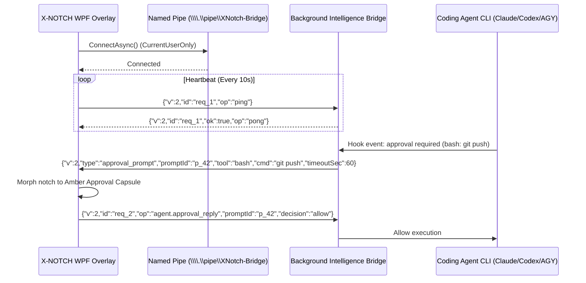

# Integration Bridge Protocol Specification (v2.0)
**X-NOTCH Autonomous Desktop Intelligence & Agent Bridge**  
*System Architect:* Principal Windows Desktop Engineer & Software Architect  

---

## 1. Transport & Security Architecture

The X-NOTCH Integration Bridge provides an isolated, robust communication link between the WPF presentation layer and external background intelligence workers (coding agent hooks, Git monitors, and AI providers).



### 1.1 Transport Rules
1. **Endpoint Name:** `\\.\pipe\XNotch-Bridge`
2. **Access Security:** Secured strictly via Windows Access Control Lists (ACLs) to the current interactive Windows user:
   ```csharp
   var security = new PipeSecurity();
   security.AddAccessRule(new PipeAccessRule(
       WindowsIdentity.GetCurrent().User!,
       PipeAccessRights.ReadWrite,
       AccessControlType.Allow));
   ```
3. **Message Framing:** Line-delimited UTF-8 JSON. Every message is exactly one line ending with `\n`.
4. **Size Limit:** Maximum single-message length is 64 KB (65,536 bytes). Messages exceeding this threshold are discarded with `error: "message_too_large"`.
5. **No Shell Execution:** The bridge never invokes `cmd.exe /c` or `powershell.exe -Command`. Subprocesses are spawned using `ProcessStartInfo.ArgumentList` with explicit string elements.

---

## 2. Standard Message Envelope

Every payload must contain the version (`v`), unique message ID (`id`), and operation or event type (`op` / `type`).

### Standard Request Envelope:
```json
{
  "v": 2,
  "id": "c9a2f76e",
  "op": "string",
  "data": {}
}
```

### Standard Response Envelope:
```json
{
  "v": 2,
  "id": "c9a2f76e",
  "ok": true,
  "data": {}
}
```

### Standard Error Envelope:
```json
{
  "v": 2,
  "id": "c9a2f76e",
  "ok": false,
  "error": "error_code",
  "detail": "Human-readable diagnostic description"
}
```

---

## 3. Operations Catalog

### 3.1 Bridge Health & Diagnostics (`op: "status"`)
**Request:**
```json
{ "v": 2, "id": "req_01", "op": "status" }
```
**Response:**
```json
{
  "v": 2,
  "id": "req_01",
  "ok": true,
  "bridge": "online",
  "version": "2.0.0",
  "installedAgents": {
    "claude": { "installed": true, "path": "C:\\Users\\User\\AppData\\Roaming\\npm\\claude.cmd" },
    "codex": { "installed": true, "path": "C:\\Users\\User\\AppData\\Local\\Programs\\OpenAI\\Codex\\bin\\codex.exe" },
    "antigravity": { "installed": true, "path": "C:\\Users\\User\\AppData\\Local\\agy\\bin\\agy.exe" }
  },
  "activeSessionsCount": 1
}
```

---

### 3.2 Agent Session Listing (`op: "agent.list"`)
**Request:**
```json
{ "v": 2, "id": "req_02", "op": "agent.list" }
```
**Response:**
```json
{
  "v": 2,
  "id": "req_02",
  "ok": true,
  "sessions": [
    {
      "agentId": "claude",
      "displayName": "Claude Code",
      "pid": 14208,
      "projectPath": "P:\\Projects\\X-Notch",
      "gitBranch": "main",
      "phase": "running_tool",
      "currentAction": "Running: dotnet build",
      "elapsedSeconds": 142,
      "requiresApproval": false
    }
  ]
}
```

---

### 3.3 Interactive Approval Event (`type: "approval_prompt"`)
Dispatched by the bridge when an agent hook requests interactive permission.

**Bridge -> Overlay Push:**
```json
{
  "v": 2,
  "type": "approval_prompt",
  "promptId": "prompt_88",
  "agentId": "antigravity",
  "tool": "bash",
  "command": "git push origin main",
  "workingDir": "P:\\Projects\\X-Notch",
  "timeoutSeconds": 60
}
```

**Overlay -> Bridge Decision Reply:**
```json
{
  "v": 2,
  "id": "req_03",
  "op": "agent.approval_reply",
  "promptId": "prompt_88",
  "decision": "allow" 
}
```
*Decisions supported:* `"allow"`, `"deny"`, `"cancel"`.

---

### 3.4 Autonomous Project Discovery (`op: "project.scan"`)
**Request:**
```json
{
  "v": 2,
  "id": "req_04",
  "op": "project.scan",
  "roots": ["P:\\Projects", "D:\\Repositories"]
}
```
**Response:**
```json
{
  "v": 2,
  "id": "req_04",
  "ok": true,
  "projectsFound": [
    {
      "name": "X-Notch",
      "path": "P:\\Projects\\X-Notch",
      "stack": ".NET 8 / WPF / C#",
      "gitBranch": "main",
      "hasUncommittedChanges": true,
      "lastModified": "2026-10-31T22:00:00Z"
    }
  ]
}
```

---

## 4. Resilience & Error Recovery

1. **Overlay Independence:** If the background bridge process crashes or is offline, the X-NOTCH WPF overlay continues operating without interruption. Media, volume, battery, clock, and local shelf tools function normally.
2. **Exponential Backoff Reconnect:** The UI attempts pipe reconnection at intervals of 1s -> 2s -> 5s -> 10s (capped at 10s) with zero Dispatcher thread stalling.
3. **Approval Expiration:** If an interactive prompt is not answered before `timeoutSeconds` elapses, the bridge automatically resolves the hook with `"timeout"` and instructs the agent to defer to its own terminal window.
