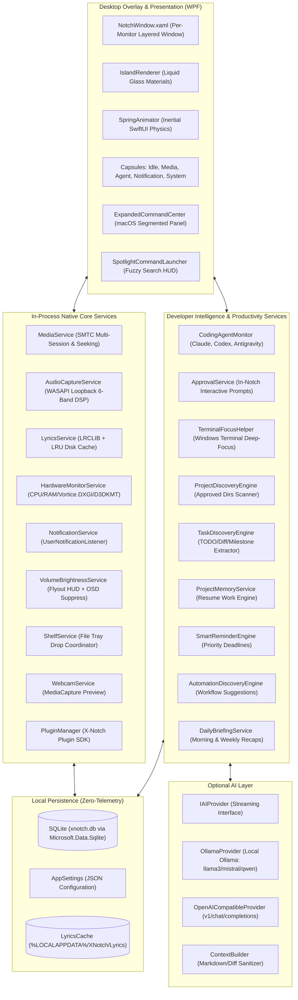
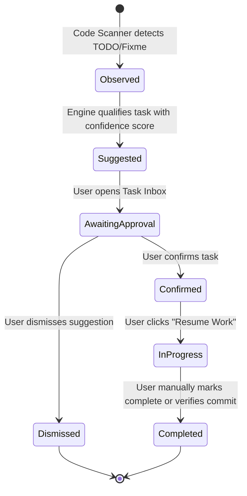

# X-NOTCH Target Architecture & Class Mapping Specification
**X-NOTCH Autonomous Desktop Intelligence**  
*System Architect:* Principal Windows Desktop Engineer & Software Architect  

---

## 1. System Architecture Overview

The target architecture organizes X-NOTCH into clean, decoupled subsystems. It maps the conceptual design directly to the existing C# WPF repository structure (`src/X-Notch`), preserving the `XNotch.PluginSdk` contract and extending the platform with native intelligence and high-performance background services.



---

## 2. Source Code Directory & Namespace Mapping

All components map directly to the `src/X-Notch` solution structure:

```text
src/X-Notch/
├── App.xaml / App.xaml.cs                 [Single-instance mutex, app lifecycle, service initialization]
├── GlobalUsings.cs                        [Global imports]
│
├── Helpers/                               [Native Win32, math, and UI utility helpers]
│   ├── AppBarHelper.cs                    [Desktop work area reservation / AppBar docking]
│   ├── BackdropBlurHelper.cs              [Windows 11 Acrylic & Mica material interop]
│   ├── D3DHelper.cs                       [D3DKMT P/Invoke for GPU temperature & adapter perf]
│   ├── GlobalHotkey.cs                    [RegisterHotKey interop for Spotlight & Toggle]
│   ├── ScreenHelper.cs                    [Multi-monitor geometry and Per-Monitor V2 DPI]
│   ├── SpringAnimation.cs                 [SwiftUI interactiveSpring solver with momentum]
│   ├── TerminalFocusHelper.cs             [Windows Terminal UI Automation & tab focus]
│   └── WindowHelper.cs                    [Layered window styles, WS_EX_TOOLWINDOW, click-through]
│
├── Models/                                [Domain models and immutable state records]
│   ├── AppSettings.cs                     [User preferences, directories, thresholds]
│   ├── AgentSession.cs                    [Agent state: Idle, Thinking, ToolUse, AwaitingApproval]
│   ├── HardwareSnapshot.cs                [CPU, RAM, GPU%, VRAM, Temp, Disk, Net]
│   ├── MediaInfo.cs                       [Track, artist, album, cover, duration, position]
│   ├── NotificationItem.cs                [Toast id, app name, title, body, timestamp]
│   ├── ProjectRecord.cs                   [Discovered project metadata, git branch, stack]
│   ├── TaskItem.cs                        [Task title, priority, status, source evidence]
│   └── NotchConstants.cs                  [Geometry, corner radii, spring tokens, color codes]
│
├── Services/                              [Core background workers and intelligence engines]
│   ├── AudioCaptureService.cs             [WASAPI loopback + 6-band loudness DSP]
│   ├── BatteryService.cs                  [Power status, AC connection, low battery alerts]
│   ├── BrightnessService.cs               [WMI brightness control and OSD suppression]
│   ├── CalendarService.cs                 [Google Calendar / Windows Calendar reader]
│   ├── ColorExtractionService.cs          [Dominant & accent color sampling from artwork]
│   ├── CodingAgentMonitor.cs              [ProcessScanner + AgentCatalog for Claude/Codex/AGY]
│   ├── ApprovalService.cs                 [Named-pipe server for interactive CLI approvals]
│   ├── FullscreenService.cs               [Detects foreground fullscreen apps / games to tuck]
│   ├── HardwareMonitorService.cs          [Consumer-gated CPU/RAM/Vortice.DXGI/D3DKMT sampler]
│   ├── LyricsService.cs                   [LRCLIB HTTP client, fuzzy matching, LRC parser]
│   ├── MediaService.cs                    [WinRT SMTC multi-session controller & scrubber]
│   ├── NotificationService.cs             [WinRT UserNotificationListener toast capture]
│   ├── ProjectDiscoveryEngine.cs          [Background scanner for user-approved directories]
│   ├── TaskDiscoveryEngine.cs             [Pattern-based extraction of TODOs and milestones]
│   ├── ProjectMemoryService.cs            [SQLite-backed project state and "Resume Work"]
│   ├── SmartReminderEngine.cs             [Priority scheduling and quiet hours enforcement]
│   ├── DailyBriefingService.cs            [Morning executive summary and weekly reviews]
│   ├── ShelfService.cs                    [Drag-and-drop file shelf buffer]
│   ├── VolumeService.cs                   [Default audio endpoint volume watcher & OSD hook]
│   └── WebcamService.cs                   [Live camera preview using MediaFrameReader]
│
├── Services/AI/                           [Optional AI providers and prompt builders]
│   ├── IAIProvider.cs                     [Streaming completions contract]
│   ├── OllamaProvider.cs                  [Local Ollama HTTP client]
│   ├── OpenAICompatibleProvider.cs        [OpenAI v1 API client]
│   └── ContextSanitizer.cs                [Redacts tokens, passwords, and PII before inference]
│
├── Persistence/                           [SQLite database access and migrations]
│   ├── XNotchDatabase.cs                  [SQLite connection management and schema creation]
│   ├── ProjectRepository.cs               [CRUD for discovered projects and history]
│   ├── TaskRepository.cs                  [CRUD for task lifecycle states]
│   └── ReminderRepository.cs              [CRUD for scheduled alerts and snooze states]
│
├── Plugins/                               [Preserved X-Notch Plugin Architecture]
│   ├── IPlugin.cs, IUIPlugin.cs, IServicePlugin.cs
│   ├── PluginManager.cs
│   └── PluginLibraryService.cs
│
└── Views/                                 [XAML Presentation and User Controls]
    ├── NotchWindow.xaml / .cs             [Master layered island container]
    ├── Components/                        [Visual components and widgets]
    │   ├── AudioVisualizer.cs             [6-band loudness waveform renderer]
    │   ├── MarqueeText.cs                 [Smooth hardware-accelerated text marquee]
    │   ├── DarkTheme.xaml                 [Liquid Glass Dark palette tokens]
    │   └── LightTheme.xaml                [Liquid Glass Light palette tokens]
    ├── Capsules/                          [Modular capsule views]
    │   ├── IdleCapsuleView.xaml           [Resting clock and quiet status dot]
    │   ├── MediaCapsuleView.xaml          [Collapsed lyric pill & live waveform]
    │   ├── AgentCapsuleView.xaml          [Agent status, duration, and approval prompt]
    │   └── NotificationCapsuleView.xaml   [Incoming toast alert card]
    ├── Panels/                            [Expanded modal panels]
    │   ├── ExpandedCommandCenter.xaml     [Multi-tab desktop dashboard]
    │   ├── SpotlightLauncher.xaml         [Centered keyboard-first search bar]
    │   ├── MusicPlayerExpandedView.xaml   [Full album art, scrub bar, controls]
    │   └── InlineSettingsView.xaml        [User configuration panel]
    └── Widgets/                           [Specialized standalone widgets]
        ├── BatteryIndicator.xaml
        ├── CalendarView.xaml
        ├── ShelfView.xaml
        └── WebcamView.xaml
```

---

## 3. Core Architectural Contracts

### 3.1 Coding Agent Lifecycle States
```csharp
public enum AgentPhase
{
    Idle,               // Process running, waiting for user input
    Thinking,           // Generating reasoning / planning
    RunningTool,        // Executing local CLI tool (e.g. bash, compiler)
    AwaitingApproval,   // Permission required (file edit, network call)
    Completed,          // Task finished successfully
    Failed              // Error encountered, tool failure, or crash
}

public sealed record AgentSessionSnapshot(
    string AgentId,         // "claude", "codex", "antigravity", "opencode"
    string DisplayName,     // "Claude Code", "OpenAI Codex", "Antigravity"
    int ProcessId,          // Active OS PID
    string ProjectPath,     // Current working directory
    string GitBranch,       // Active Git branch if repository detected
    AgentPhase Phase,       // Current operational state
    string CurrentAction,   // Human-readable status (e.g. "Running: dotnet test")
    TimeSpan ElapsedTime,   // Session active duration
    bool RequiresApproval   // True if interactive prompt is pending
);
```

### 3.2 Task Lifecycle Model
To prevent erroneous auto-completion, tasks transition strictly through verified state stages:



### 3.3 Consumer-Gated Hardware Monitoring
```csharp
public sealed class HardwareMonitorService : IDisposable
{
    private int _activeConsumers = 0;
    private readonly AutoResetEvent _wakeEvent = new(false);

    public void RegisterConsumer()
    {
        if (Interlocked.Increment(ref _activeConsumers) == 1)
        {
            _wakeEvent.Set(); // Resume background sampling loop
        }
    }

    public void UnregisterConsumer()
    {
        Interlocked.Decrement(ref _activeConsumers);
    }
}
```
When the Expanded Command Center is collapsed or navigating away from the System tab, `_activeConsumers` drops to 0, causing the sampling thread to enter a non-polling wait state with zero CPU overhead.
