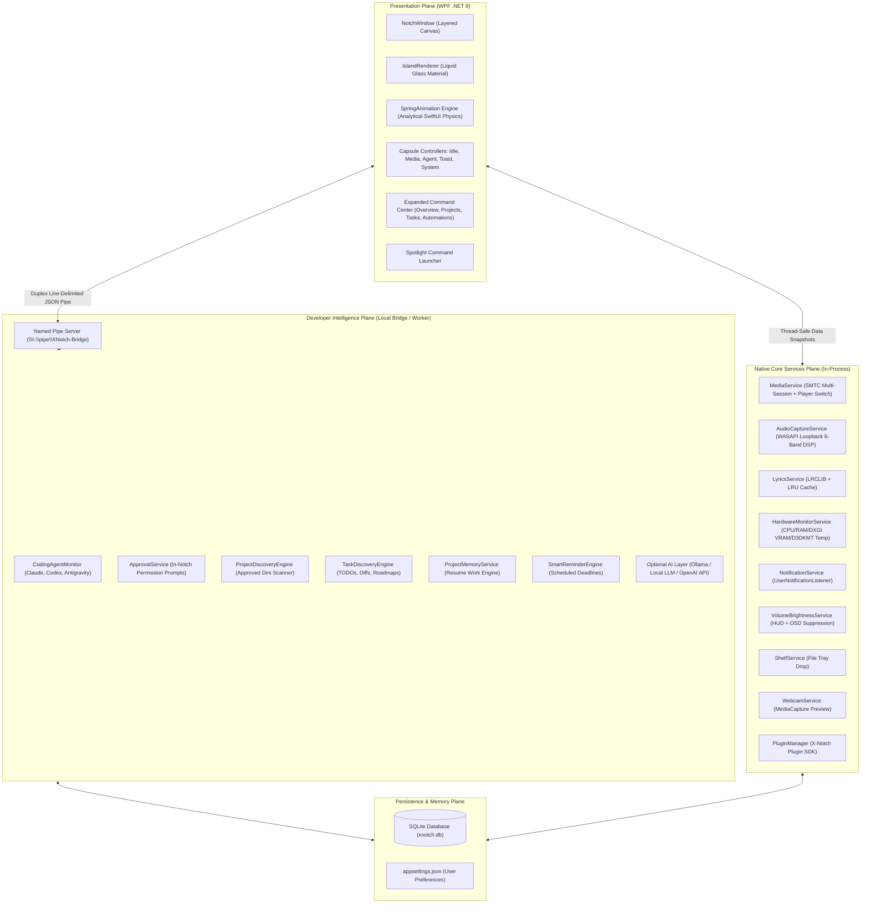

# Architectural Topologies & Reference Models
**X-NOTCH Autonomous Desktop Intelligence**  
*Auditor:* Principal Windows Desktop Engineer & Software Architect  

---

## 1. Comparative Architectural Topologies

During our Repository Evidence Analysis (REA), four distinct architectural models were discovered among the candidate projects:

```mermaid
flowchart TD
    subgraph Arch1["1. Monolithic Single-Process (X-Notch, V-Notch)"]
        UI1["WPF Overlay & Windows"] --> Core1["Core Services (Media, Shelf, Audio)"]
        Core1 --> Plugins1["In-Process Plugin Instances"]
    end

    subgraph Arch2["2. Injected In-Process Hook (Windhawk Fork)"]
        Windhawk["Windhawk.exe Host"] --> HookProcess["Injected Tool-Mod Process"]
        HookProcess --> Direct2D["Direct2D Render Loop"]
        HookProcess --> WinHooks["Win32 Global Hooks (Mouse, Keyboard)"]
    end

    subgraph Arch3["3. Multi-Process Bridge (Dynamic Island v2, WNotch)"]
        UI3["UI Desktop Overlay"] <-->|Named Pipe JSON IPC| Bridge3["Background Service / CLI Bridge"]
        Bridge3 --> Agents3["Coding Agents (Claude, Codex, Antigravity)"]
        Bridge3 --> System3["External APIs & OAuth Brokers"]
    end

    subgraph Arch4["4. X-NOTCH Target Hybrid Architecture"]
        Overlay["WPF Fluid Liquid Glass Overlay"] <-->|Dispatcher Safe| CoreServices["In-Process High-Speed Native Services"]
        CoreServices --> SQLite["Local SQLite Database"]
        Overlay <-->|Named Pipe CurrentUserOnly| LocalBridge["X-NOTCH Background Intelligence Bridge"]
        LocalBridge --> AgentAdapters["Agent Adapters & Hook Servers"]
        LocalBridge --> AutoEngines["Autonomous Discovery Engines"]
    end
```

---

## 2. Detailed Reference Architectures

### 2.1 Model 1: Monolithic Single-Process (X-Notch, V-Notch)
- **Characteristics:** Everything executes inside a single WPF `.exe` process. Background services run on worker threads (`Task.Run` or dedicated threads) and dispatch updates to the UI via `Dispatcher.BeginInvoke`.
- **Advantages:**
  - Zero IPC overhead; instantaneous method calls.
  - Simple deployment (single folder or standalone `.exe`).
  - Seamless memory sharing between UI controls and plugin instances.
- **Vulnerabilities:**
  - If a long-running external process (like an agent compiler or Git scanner) blocks or crashes, it risks freezing the WPF Dispatcher.
  - Heavy CLI execution cannot easily be sandbox-isolated.

---

### 2.2 Model 2: Injected In-Process Tool-Mod (Fork-Dynamic-Island-Windhawk)
- **Characteristics:** Injected into `windhawk.exe`, creating a custom Win32 layered window rendered via Direct2D and DirectWrite. Runs low-level mouse and keyboard hooks (`WH_MOUSE_LL`, `WH_KEYBOARD_LL`).
- **Advantages:**
  - Ultimate rendering efficiency: per-pixel alpha, hardware Direct2D composition, negligible memory footprint (28MB).
  - Can intercept Windows shell flyouts and OSD windows directly.
- **Vulnerabilities:**
  - Requires the Windhawk runtime to be installed.
  - C++ memory safety risks; debugging requires kernel/log-tracing tools.
  - Rigid extension model: adding complex AI or database persistence requires writing extensive C++ COM plumbing.

---

### 2.3 Model 3: Multi-Process Bridge (Dynamic Island v2, WNotch)
- **Characteristics:** The UI is strictly a display client. All heavy I/O, agent process launching, and external service communication occur in an out-of-process bridge communicating over named pipes.
- **Advantages:**
  - Total UI isolation: even if an agent crashes or hangs, the overlay remains 100% fluid and responsive.
  - Clean security boundaries: `NamedPipeServerStream` restricted to `PipeOptions.CurrentUserOnly`.
  - Process arguments are safely passed via `ProcessStartInfo.ArgumentList` with zero shell interpolation.
- **Vulnerabilities:**
  - Serialization overhead for high-frequency events (mitigated by line-delimited UTF-8 JSON).
  - Lifecycle management: must ensure bridge process shuts down cleanly when the overlay exits.

---

## 3. The X-NOTCH Target Hybrid Architecture

X-NOTCH adopts a **Hybrid Split-Plane Architecture** that combines the strengths of Model 1 (for ultra-low-latency UI and native Windows media/audio services) and Model 3 (for heavy developer intelligence, background Git/project discovery, and agent hook servers).

### 3.1 Logical Architecture Blueprint

---

## 4. Concurrency & State Synchronization Model

1. **Thread Separation:**
   - **WPF UI Thread (Dispatcher):** Only handles XAML rendering, layout computation, hit-testing, and spring animation updates. No network, disk I/O, or heavy process scanning is ever allowed on this thread.
   - **Core Service Workers:** Run on threadpool tasks (`Task.Run`) or dedicated background threads (e.g. WASAPI audio loopback).
   - **Intelligence Bridge Workers:** Run completely decoupled from the UI, transmitting structured JSON events over the named pipe.
2. **Immutable State Snapshots:**
   - Instead of locking UI properties, workers generate immutable record snapshots (e.g., `HardwareSnapshot`, `MediaSnapshot`, `AgentSessionSnapshot`) and dispatch them via `Dispatcher.BeginInvoke`.
3. **Consumer-Driven Gating:**
   - Heavy background loops (GPU counters, hardware sensors) only increment sample counters when an active consumer view requests them. When the notch is collapsed or resting in idle mode, background hardware polling halts automatically.
