# Incremental Implementation Roadmap
**X-NOTCH Autonomous Desktop Intelligence**  
*Lead Engineer & System Architect:* Principal Windows Desktop Engineer & Project Lead  

---

## 1. Roadmap Principles & Phasing Strategy

To ensure zero regressions, continuous testability, and rock-solid native Windows stability, development is structured into 11 strictly sequenced phases. Every phase culminates in a green test build before advancing.

```mermaid
flowchart LR
    P0["P0: Audit & Baseline"] --> P1["P1: Design System & Motion"]
    P1 --> P2["P2: Media, DSP & Hardware"]
    P2 --> P3["P3: Notifications & Spotlight"]
    P3 --> P4["P4: Developer Command Center"]
    P4 --> P5["P5: Autonomous Discovery"]
    P5 --> P6["P6: SQLite Memory & Reminders"]
    P6 --> P7["P7: Automation Intelligence"]
    P7 --> P8["P8: Optional AI Providers"]
    P8 --> P9["P9: Plugin Ecosystem"]
    P9 --> P10["P10: Verification & Release"]
```

---

## 2. Phase Breakdown & Deliverables

### Phase 0: Baseline Project Audit & Verification
- **Status:** **COMPLETE** (Evidence in `research/REA_REPOSITORY_AUDIT.md` & `research/IMPLEMENTATION_EVIDENCE.md`).
- **Achievements:**
  - Audited existing X-Notch solution (`X-Notch.sln`).
  - Baseline build confirmed with .NET 8 (0 errors, 2 warnings).
  - 10 unit tests passing (`SpringAnimatorTests`, `PluginManifestTests`).
  - 9 reference repositories cloned and analyzed.

---

### Phase 1: Design System & Interaction Foundation
- **Objective:** Establish the macOS Liquid Glass visual tokens, spring motion solver, and unified capsule window controller.
- **Tasks:**
  1. Complete integration of `SpringAnimator` in `src/X-Notch/Helpers/SpringAnimation.cs` with momentum and velocity continuity.
  2. Implement Liquid Glass palette tokens in `src/X-Notch/Views/Components/DarkTheme.xaml` and `LightTheme.xaml`.
  3. Refine `NotchConstants.cs` geometry (concentric corner radii: 16px collapsed, 24px expanded).
  4. Ensure Per-Monitor DPI V2 scaling and multi-monitor docking remain flawless.
- **Verification:** Build passes; spring physics tests pass with zero NaN or overshoot instability.

---

### Phase 2: Core Island & System Integrations
- **Objective:** Upgrade Media, Audio DSP, Synced Lyrics, and Hardware Monitoring.
- **Tasks:**
  1. **SMTC Multi-Session Controller:** Add `GetSessions()` enumeration, session cycling via chevrons (`‹` / `›`), and active player pinning to `MediaService.cs`.
  2. **6-Band Loudness Waveform DSP:** Enhance `AudioCaptureService.cs` with the 6-band RBJ filterbank and ear-sensitivity weighting.
  3. **LRCLIB Synced Lyrics:** Implement `LyricsService.cs` with normalized track caching and dynamic capsule widening.
  4. **Hardware Monitor Service:** Implement `HardwareMonitorService.cs` with consumer-gated sampling:
     - CPU load & clock frequency via Win32 / PDH.
     - RAM used / total GB via `GlobalMemoryStatusEx`.
     - Dedicated VRAM via `Vortice.DXGI`.
     - GPU temperature via D3DKMT dynamic P/Invoke (`gdi32.dll`).
- **Verification:** Unit tests for LRC parser; hardware sampler halts when consumer count is 0.

---

### Phase 3: Notifications, Quick Tools & Spotlight Launcher
- **Objective:** Integrate Windows toast listening, HUD overlay, and keyboard search launcher.
- **Tasks:**
  1. **Toast Notification Listener:** Implement `NotificationService.cs` using WinRT `UserNotificationListener`.
  2. **Inline Alerts:** Allow incoming toasts to display inline inside the media capsule or as a dedicated notification card.
  3. **Spotlight Command Launcher:** Implement `SpotlightLauncher.xaml` with fuzzy search across open apps, projects, and system actions (`Ctrl+Space`).
- **Verification:** Mock toast injection test; verify non-elevated notification capture.

---

### Phase 4: Developer Command Center & Agent Bridge
- **Objective:** Transform X-NOTCH into an intelligent HUD for coding agents.
- **Tasks:**
  1. **Agent Process Scanner:** Implement `CodingAgentMonitor.cs` with `AgentCatalog.cs` recognizing Claude Code, Codex, Antigravity (`agy`), and OpenCode.
  2. **Approval Service:** Implement `ApprovalService.cs` over named pipe (`\\.\pipe\XNotch-Bridge`).
  3. **Interactive Approval UI:** Add in-notch interactive approval dialog with "Approve" (`Enter`) and "Deny" (`Esc`).
  4. **Windows Terminal Deep Focus:** Implement `TerminalFocusHelper.cs` to focus the exact terminal tab hosting an active session.
- **Verification:** End-to-end integration test with mock agent hook message and approval response.

---

### Phase 5: Autonomous Project & Task Discovery
- **Objective:** Zero-touch background discovery of projects and tasks in approved directories.
- **Tasks:**
  1. **Project Discovery Engine:** Implement `ProjectDiscoveryEngine.cs` scanning designated roots (e.g. `P:\`, `C:\Users\...\source`) for `.git`, `.csproj`, `package.json`, `Cargo.toml`.
  2. **Task Discovery Engine:** Parse uncommitted Git diffs, `TODO:` / `FIXME:` code comments, and roadmap markdown files.
  3. **Task Lifecycle Pipeline:** Enforce task state machine (`Observed → Suggested → Awaiting Approval → Confirmed → In Progress → Completed`).
- **Verification:** Directory scanning benchmark: < 200ms for 50 local repositories.

---

### Phase 6: Project Memory, Resume Work & Smart Reminders
- **Objective:** Local SQLite persistence, instant workspace resumption, and priority alerting.
- **Tasks:**
  1. **SQLite Database:** Implement `XNotchDatabase.cs` using `Microsoft.Data.Sqlite`.
  2. **Project Memory Service:** Store active Git branch, last edited files, and last confirmed milestone.
  3. **"Resume Work" Action:** Opens the selected project in VS Code, Antigravity IDE, or Windows Terminal in 1 click.
  4. **Smart Reminder Engine:** Priority-based alert scheduler respecting Windows Focus Assist / Quiet Hours.
- **Verification:** SQLite read/write benchmark (< 5ms per transaction); database migration test.

---

### Phase 7: Automation Intelligence
- **Objective:** Suggest safe, approved desktop automations.
- **Tasks:**
  1. **Automation Discovery:** Detect repeated tasks (daily git status, project builds).
  2. **Approval Sandbox:** Present automation proposals with explicit triggers, actions, and safety warnings. Require manual user approval before activation.
- **Verification:** Verify no arbitrary shell execution occurs without explicit confirmation.

---

### Phase 8: Optional AI Layer (Ollama & OpenAI-Compatible)
- **Objective:** Provide local-first, privacy-respecting LLM summaries and classifications.
- **Tasks:**
  1. Implement `IAIProvider.cs`, `OllamaProvider.cs`, and `OpenAICompatibleProvider.cs`.
  2. Sanitize prompts via `ContextSanitizer.cs` before sending to external endpoints.
  3. Use AI strictly for extraction and summaries; core application functionality remains 100% operational offline without AI.
- **Verification:** Test offline fallback behavior when Ollama or API is unavailable.

---

### Phase 9: Plugin Ecosystem & Backwards Compatibility
- **Objective:** Ensure all existing X-Notch plugins continue to function.
- **Tasks:**
  1. Verify `XNotch.PluginSdk` interfaces (`IPlugin`, `IUIPlugin`, `IServicePlugin`) remain unmodified.
  2. Test example plugins: `BetterAnimationPlugin`, `FocusTimerPlugin`, `ClipboardStackPlugin`.
- **Verification:** All 6 example plugins load and execute without errors.

---

### Phase 10: Performance Optimization, Testing & Release
- **Objective:** Final verification against performance budgets and release packaging.
- **Tasks:**
  1. Execute complete test suite (unit + integration).
  2. Profile CPU, GPU, and RAM usage under resting, media playback, and expanded dashboard workloads.
  3. Compile Release configuration.
- **Verification:** Idle CPU < 0.5%, idle RAM < 65 MB.
