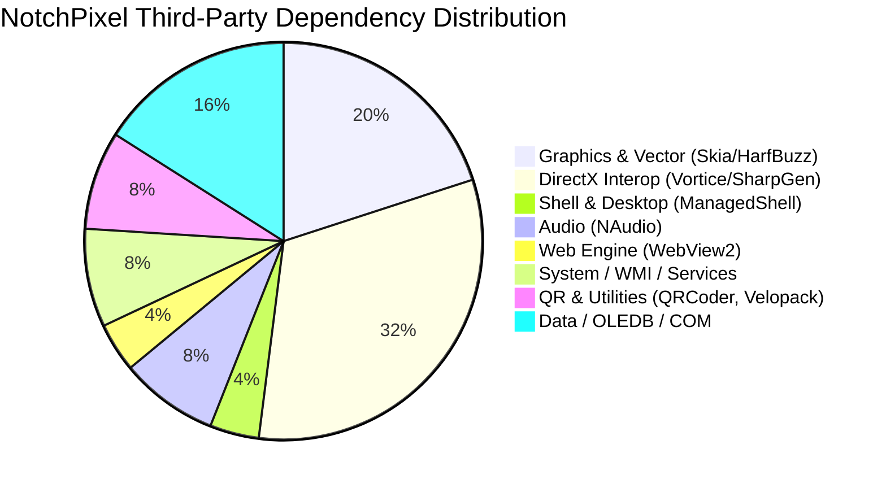

# APPLICATION STRUCTURE & COMPONENT BREAKDOWN
## Target Application: NotchPixel (v0.5.113.0)

---

### 1. Package & Filesystem Architecture

NotchPixel is distributed as a packaged Windows Application (MSIX / AppX) installed to the WindowsApps repository:
`C:\Program Files\WindowsApps\KOREINDUSTRIES.NotchPixel_0.5.113.0_x64__qgfctd1hmk5vm`

#### 1.1 Root Package Directory Layout

The installation root contains 187 files totaling approximately 142 MB. The critical binaries and subsystems break down as follows:

| Component Category | Key Files / Binaries | Purpose / Subsystem |
| :--- | :--- | :--- |
| **Main Executable & Logic** | `NotchPixel.exe`<br>`NotchPixel.dll`<br>`NotchPixel.Core.dll` | Application bootstrap, shell logic, and scene management. |
| **Runtime Host (.NET 10)** | `hostfxr.dll`<br>`hostpolicy.dll`<br>`coreclr.dll`<br>`clrjit.dll`<br>`clrgc.dll` | .NET Core 10.0.14 runtime engine and JIT compiler. |
| **DirectX / DirectComposition** | `Vortice.Direct3D11.dll`<br>`Vortice.Direct3D12.dll`<br>`Vortice.Direct2D1.dll`<br>`Vortice.DirectComposition.dll`<br>`Vortice.DXGI.dll` | Low-level hardware rendering interop to D3D and DWM. |
| **2D Vector & Canvas** | `SkiaSharp.dll`<br>`libSkiaSharp.dll`<br>`HarfBuzzSharp.dll`<br>`libHarfBuzzSharp.dll` | High-performance 2D rasterization, path rendering, and font shaping. |
| **Shell & Desktop Interop** | `ManagedShell.AppBar.dll`<br>`ManagedShell.Common.dll`<br>`ManagedShell.Interop.dll`<br>`ManagedShell.WindowsTasks.dll`<br>`ManagedShell.WindowsTray.dll`<br>`ManagedShell.UWPInterop.dll` | Win32 AppBar integration, taskbar auto-hide hooks, tray interception. |
| **Audio Processing** | `NAudio.Core.dll`<br>`NAudio.Wasapi.dll` | Low-latency WASAPI loopback audio stream capture and volume monitoring. |
| **Embedded Web Engine** | `Microsoft.Web.WebView2.Core.dll`<br>`Microsoft.Web.WebView2.Wpf.dll`<br>`WebView2Loader.dll` | Chromium webview runtime for web panels, live chats, and web tiles. |
| **Windows App SDK / WinRT** | `Microsoft.Windows.SDK.NET.dll`<br>`WinRT.Runtime.dll` | Projection of modern Windows 10/11 WinRT APIs into .NET. |
| **Installer & Auto-Update** | `Velopack.dll` | Delta auto-update and package release lifecycle management. |

---

### 2. Runtime Configuration (`NotchPixel.runtimeconfig.json`)

The application targets `.NET 10.0` with custom Garbage Collection (GC) properties explicitly tuned for reduced memory footprint on desktop systems:

```json
{
  "runtimeOptions": {
    "tfm": "net10.0",
    "includedFrameworks": [
      { "name": "Microsoft.NETCore.App", "version": "10.0.14" },
      { "name": "Microsoft.WindowsDesktop.App", "version": "10.0.14" }
    ],
    "configProperties": {
      "System.GC.ConserveMemory": 5,
      "System.GC.RetainVM": false,
      "System.GC.Gen0MaxBudget": 4194304,
      "System.GC.Concurrent": true,
      "System.GC.Server": false,
      "System.Globalization.Invariant": false,
      "System.Reflection.Metadata.MetadataUpdater.IsSupported": false,
      "System.Resources.UseSystemResourceKeys": true,
      "System.Runtime.Serialization.EnableUnsafeBinaryFormatterSerialization": false,
      "System.Runtime.TieredPGO": false,
      "CSWINRT_USE_WINDOWS_UI_XAML_PROJECTIONS": false
    }
  }
}
```

#### Key GC & CLR Tuning Insights:
- `System.GC.Server = false`: Configured for **Workstation GC** to minimize background GC thread count.
- `System.GC.ConserveMemory = 5`: High memory conservation level (scale 0-9), forcing more aggressive trimming of heap segments.
- `System.GC.Gen0MaxBudget = 4194304`: Gen0 heap allocation budget capped at 4 MB to induce frequent, short collections.
- `CSWINRT_USE_WINDOWS_UI_XAML_PROJECTIONS = false`: Disables Windows UI XAML projections in WinRT to save overhead since WPF and Skia are used instead of WinUI XAML.

---

### 3. Dependency Inventory (from `NotchPixel.deps.json`)

The application consumes 25 NuGet package packages, categorized by architectural purpose:



1. **DirectX & Native Rendering**:
   - `Vortice.Direct3D11` (v3.8.3), `Vortice.Direct3D12` (v3.8.3), `Vortice.Direct2D1` (v3.8.3), `Vortice.DirectComposition` (v3.8.3), `Vortice.DXGI` (v3.8.3), `Vortice.DirectX` (v3.8.3), `Vortice.Mathematics` (v2.1.0), `Vortice.MediaFoundation` (v3.8.3), `SharpGen.Runtime` (v2.4.2-beta).
2. **Skia 2D Canvas**:
   - `SkiaSharp` (v4.152.1), `SkiaSharp.Direct3D.Vortice` (v4.152.1), `SkiaSharp.HarfBuzz` (v4.152.1), `SkiaSharp.NativeAssets.Win32` (v4.152.1), `HarfBuzzSharp` (v14.2.1.201), `HarfBuzzSharp.NativeAssets.Win32` (v14.2.1.201).
3. **Shell Hooks**:
   - `ManagedShell` (v0.0.374) — open-source library for shell replacements providing AppBar APIs, System Tray hooks, Taskbar window tracking, and Start Menu UWP indexing.
4. **Audio Subsystem**:
   - `NAudio.Core` (v2.2.0), `NAudio.Wasapi` (v22.0.0).
5. **Web Subsystem**:
   - `Microsoft.Web.WebView2` (v1.0.4191.47).
6. **System & Update**:
   - `Velopack` (v1.2.0), `QRCoder` (v1.8.0), `System.Management` (v10.0.12), `System.ServiceProcess.ServiceController` (v8.0.1).

---

### 4. Asset Structure & Typography

All embedded visual assets reside under the package `Assets/` hierarchy:

#### 4.1 Typography Assets (`Assets/Fonts/`)
NotchPixel relies heavily on modern, minimalist sans-serif typography paired with monospaced and rounded display fonts:
- `Geist-Regular.ttf` (123 KB) — Primary UI body text.
- `Geist-Medium.ttf` (125 KB) — Secondary headings, widget subtext.
- `Geist-SemiBold.ttf` (125 KB) — Card titles, status banners.
- `Geist-Bold.ttf` (126 KB) — Heavy metric readouts.
- `GeistMono-Regular.ttf` (145 KB) — Monospaced timer and time readouts.
- `GeistMono-Medium.ttf` (146 KB) — System performance statistics (FPS, CPU %, RAM %).
- `GeistPixel-Square.ttf` (92 KB) — Custom pixel font used for the retro visualizer and pixel pet.
- `Quicksand-Bold.otf` (29 KB) — Rounded display font used for the playful notch branding and welcome screens.

#### 4.2 Application Icons & Identity (`Assets/`)
- `StoreLogo.png` (50x50)
- `Square44x44Logo.png`
- `Square150x150Logo.png`
- `Wide310x150Logo.png`

---

### 5. User Data & State Repository

All runtime persistence, settings, logs, and caches reside in the isolated AppData folder:
`%LOCALAPPDATA%\Packages\KOREINDUSTRIES.NotchPixel_qgfctd1hmk5vm\LocalCache\Roaming\NotchPixel\`

| File Name | Typical Size | Description / Function |
| :--- | :--- | :--- |
| `settings.json` | ~9.3 KB | Primary JSON user preferences and feature flags. |
| `settings.json.bak` | ~9.3 KB | Automatic backup created prior to write transactions. |
| `surface-safety.json` | 143 B | Crash counter and fallback state machine (safeguards display surface changes). |
| `notchpixel.log` | 10 KB - 500 KB | Plaintext diagnostic execution log with millisecond timestamps. |
| `clipboard.dat` | 16 KB - 100 KB | Serialized history of copied clipboard items and metadata. |
| `icon-cache` | Variable | Binary database of cached Win32/UWP application icons. |
| `tray-announced` | 14 B | Epoch timestamp tracking when system tray balloon hints were announced. |
| `running.marker` | 4 B | Lockfile present exclusively while the process is active. |
