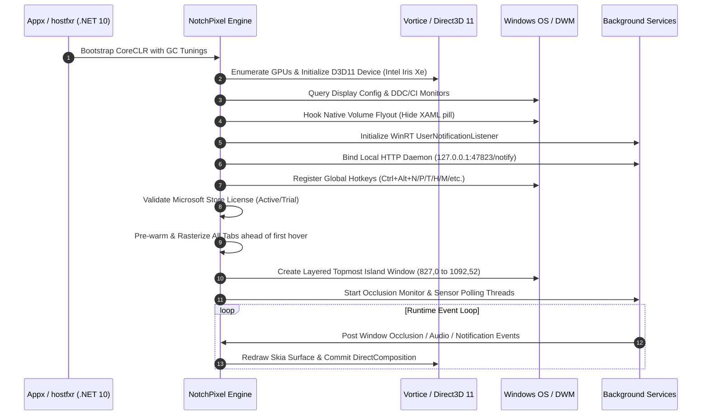
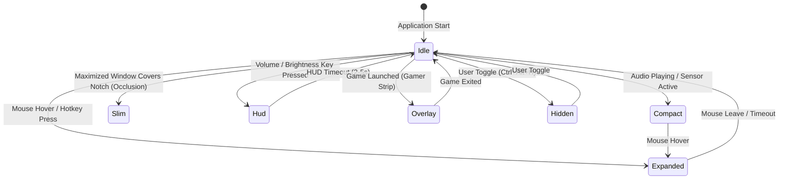

# ARCHITECTURE ANALYSIS: EXECUTION PIPELINE & SUBSYSTEMS
## Target Application: NotchPixel (v0.5.113.0)

---

### 1. Architectural Overview & System Composition

NotchPixel is a hybrid desktop application combining a low-level **DirectComposition / SkiaSharp** rendering layer with a high-level **WPF (.NET 10)** application chrome.

The architecture is partitioned into four major structural tiers:

```mermaid
graph TD
    subgraph UI_Surface["1. Presentation & Surface Layer"]
        TopWindow["Topmost Island Window (HWND)"]
        DCompVisual["DirectComposition Visual Tree"]
        SkiaSurface["SkiaSharp D3D11 Render Target"]
        SettingsUI["Settings Window (WPF XAML)"]
    end

    subgraph Scene_Graph["2. Scene Graph & Hit Testing"]
        IslandState["Island State Machine (7 Modes)"]
        CardRegistry["Card Panel Registry (14 Panels)"]
        HitEngine["IslandHit Dispatcher (100+ Zones)"]
        SpringAnim["Spring Physics & Morph Interpolator"]
    end

    subgraph Service_Tier["3. Background Services & Integration Tier"]
        OcclusionMon["Window Occlusion Monitor (DWM/Win32)"]
        AudioEngine["WASAPI Audio Loopback & Visualizer"]
        NotifyListener["WinRT UserNotificationListener"]
        SensorPoller["WMI / DDC-CI Sensor Poller"]
        HttpDaemon["Phone Share HTTP Server (Port 47823)"]
        ShellHooks["ManagedShell AppBar & Tray Interceptor"]
    end

    subgraph Platform_Core["4. OS Platform & Core Runtime"]
        Win32["Win32 User32 / Kernel32 / GDI32"]
        DirectX["Direct3D 11/12 & DXGI (Vortice)"]
        CLR["NET 10 CoreCLR & Workstation GC"]
        WinRT["Windows App SDK / Modern Projections"]
    end

    UI_Surface --> Scene_Graph
    Scene_Graph --> Service_Tier
    Service_Tier --> Platform_Core
```

---

### 2. Execution Pipeline & Application Lifecycle

Through detailed analysis of `notchpixel.log` and process startup sequences, the complete bootstrap-to-shutdown lifecycle is mapped as follows:

#### Detailed Phase Breakdown:

1. **Bootstrap & Environment Detection**:
   - `hostfxr.dll` reads `NotchPixel.runtimeconfig.json` and spins up the `.NET 10.0.14` runtime.
   - Applies Workstation GC settings with a 4 MB Gen0 budget and memory conservation level 5.
   - Determines primary monitor dimensions (1920x1080 @ 125% DPI scaling -> 1536x864 effective DIPs).

2. **Display & Hardware Adapter Enumeration**:
   - Enumerates DXGI adapters and creates a `Direct3D 11` hardware device on the primary GPU (`Intel Iris Xe Graphics`).
   - Probes monitor brightness capabilities: built-in display panel via WMI/Direct3D and external displays via DDC/CI (`BrightnessWay.Panel` vs `BrightnessWay.Monitor`).

3. **System Flyout Interception**:
   - Injects a window hook / shell suppression that disables the default Windows 11 XAML volume flyout pill above the taskbar, replacing it with NotchPixel's volume HUD.

4. **Service Initialization**:
   - **Notification Service**: Requests access to `Windows.UI.Notifications.Management.UserNotificationListener`.
   - **Local HTTP Daemon**: Binds a lightweight HTTP listener to `http://127.0.0.1:47823/notify` to receive phone notifications and file drop uploads.
   - **Global Hotkey Registration**: Calls `RegisterHotKey` for 11 configurable key combinations. If a conflict occurs (e.g., `Ctrl+Alt+M`), automatically falls back to an alternate modifier (`Ctrl+Alt+Shift+M`).
   - **Store Licensing**: Checks `Windows.Services.Store.StoreContext` for active license / trial days remaining (7-day trial).

5. **Pre-Warming & Rendering Setup**:
   - Initializes `SkiaSharp` surface backed by a D3D11 swapchain.
   - Executes a warm-up cycle: forcibly draws all 14 card panels once in memory to prime shaders, glyph caches, and layout buffers before the user ever hovers.

6. **Occlusion & Active Monitoring Loop**:
   - Spawns background worker threads to monitor foreground window handles (`GetForegroundWindow`, `GetWindowRect`).
   - When a maximized window covers the coordinates `(827, 0) - (1092, 52)`, triggers `IslandMode.Slim` or `IslandMode.Hidden`.

---

### 3. Rendering Subsystem & Window Architecture

#### 3.1 Window Construction
- The primary notch window is created as a Win32 popup window with extended styles:
  - `WS_POPUP` (`0x80000000`)
  - `WS_EX_TOPMOST` (`0x00000008`) — Ensures visibility over standard desktop windows.
  - `WS_EX_TOOLWINDOW` (`0x00000080`) — Keeps the notch hidden from the Alt+Tab task switcher.
  - `WS_EX_LAYERED` (`0x00080000`) — Supports per-pixel alpha blending and DirectComposition surfaces.
  - `WS_EX_NOACTIVATE` (`0x08000000`) — Prevents stealing keyboard focus when hovered or clicked.

#### 3.2 DirectComposition Pipeline
Rather than relying on classic GDI `UpdateLayeredWindow` (which causes high CPU and copy latency), NotchPixel uses `Vortice.DirectComposition`:
1. SkiaSharp renders 2D vector shapes, text glyphs (`HarfBuzzSharp`), and shadows to an offscreen D3D11 texture surface.
2. The surface is associated with a DirectComposition visual (`IDCompositionVisual`).
3. The visual is committed to the DWM compositor (`IDCompositionDevice::Commit()`).
4. This yields smooth alpha-blended transparency, rounded corners, and drop shadows with hardware GPU acceleration.

---

### 4. Island State Machine

The core user experience is governed by a finite state machine defined in `NotchPixel.Scene.IslandMode`:

| State (`IslandMode`) | Geometry (at 100% scale) | Behavior / Visual Content |
| :--- | :--- | :--- |
| **Idle** | `265 x 52 px` (centered top) | Minimal black pill adhering to bezel; shows clock, pet, or remains blank. |
| **Compact** | `320 x 52 px` | Shows mini album art + wave visualizer or timer readout. |
| **Slim** | `180 x 8 px` (line) | Shrinks to a thin unobtrusive line when a maximized window covers it. |
| **Expanded** | `640 x 420 px` (card) | Full interactive panel (Media controls, Shelf, Clipboard, Widgets, etc.). |
| **Hud** | `300 x 60 px` | Temporary visual feedback for volume, brightness, battery, or mic state. |
| **Overlay** | Full width / strip | Gamer overlay strip displaying FPS, CPU %, GPU %, RAM, Network. |
| **Hidden** | `0 x 0 px` | Completely unmapped / invisible until hotkey trigger. |

---

### 5. Architectural Critique & Bottlenecks

While NotchPixel's feature set is extensive, reverse engineering revealed major architectural flaws that X-Notch must avoid:

1. **Continuous Idle CPU Consumption (~1.6%)**:
   - NotchPixel relies on high-frequency timer loops to poll WMI sensors, GPU loads, and window occlusion states.
   - *X-Notch Solution*: Implement event-driven OS hooks (`SetWinEventHook` for window moves/maximization, `IAudioEndpointVolumeCallback` for volume, zero-polling sensor updates).

2. **Excessive Thread & Handle Count (57 Threads, 1,090 Handles)**:
   - Separate worker threads are spawned for WASAPI audio capture, HTTP listening, DDC/CI polling, WMI polling, and clipboard snooping.
   - *X-Notch Solution*: Consolidate background operations into an asynchronous Task / thread-pool model, reducing idle threads to <12.

3. **WPF / DirectComposition Impedance Mismatch**:
   - The settings window is a standard WPF window, while the notch is a DirectComposition Skia surface. This causes severe context switching, double memory footprints, and unhandled WPF state bugs (e.g. `InvalidOperationException` on maximize).
   - *X-Notch Solution*: Unified UI technology stack using WinUI 3 / modern Windows App SDK throughout the entire application.
