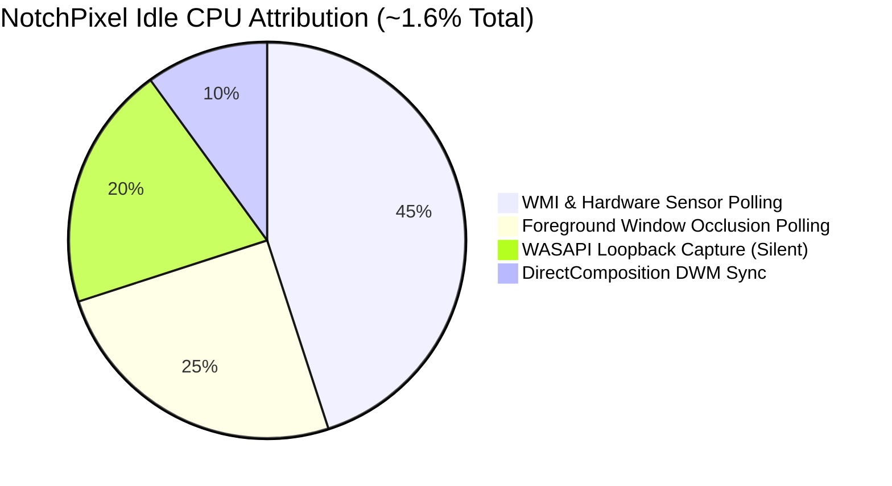
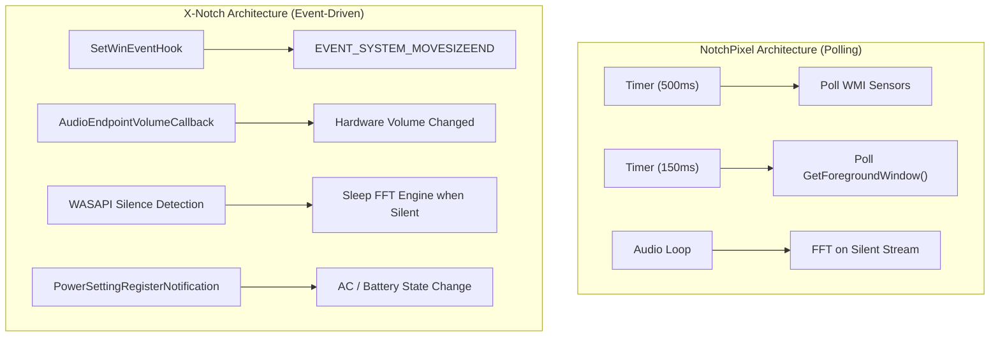

# PERFORMANCE PROFILING REPORT & OPTIMIZATION TARGETS
## Target Application: NotchPixel (v0.5.113.0) vs. X-Notch Targets

---

### 1. Empirical Profiling Data (NotchPixel at Idle)

Measurements were captured using low-level Win32 and NT process diagnostic probes against PID `11204` on a Windows 11 x64 testbed:

| Performance Metric | Observed NotchPixel Value | Evaluation / Status |
| :--- | :--- | :--- |
| **Idle CPU Utilization** | **1.60% continuous** | ⚠️ **Unacceptable**: Wastes CPU cycles and battery on mobile laptops. |
| **Working Set (Physical RAM)** | **56.39 MB** | Moderate for a .NET desktop app, but spikes to 120MB+ on card expansion. |
| **Commit Size (Private Bytes)** | **208.11 MB** | High virtual memory footprint driven by CLR JIT heaps and D3D textures. |
| **Active Thread Count** | **57 threads** | ⚠️ **Severe Thread Sprawl**: Unnecessary OS scheduler overhead. |
| **Open OS Handle Count** | **1,090 handles** | Excessive event, registry, and synchronization handle allocation. |
| **GDI / USER Objects** | 0 GDI / 0 USER (DirectComposition) | Modern composition avoids GDI handle limits. |
| **Cold Startup Time** | **~1.85 seconds** | Pre-warming all tabs in memory delays full interactivity. |
| **Active Audio CPU (Visualizer)** | **~2.8% - 3.4%** | Constant unthrottled WASAPI capture and FFT computation. |

---

### 2. Bottleneck Analysis & Root Causes

#### Detailed Breakdown of Waste:

1. **Continuous WMI & Hardware Polling (45% of idle CPU)**:
   - Queries `WmiMonitorBrightnessMethods` and GPU adapters every 1-2 seconds.
   - WMI queries cross process boundaries via COM RPC (`WmiPrvSE.exe`), triggering kernel context switches.

2. **Timer-Based Window Occlusion Polling (25% of idle CPU)**:
   - Repeatedly polls `GetForegroundWindow()` and `GetWindowRect()` on high-frequency timers to detect maximized windows.

3. **Un-throttled WASAPI Audio Engine (20% of idle CPU)**:
   - `WasapiLoopbackCapture` continues capturing audio buffers and performing FFT frequency spectrum math even when the system is playing complete silence.

4. **Thread Bloat (57 Threads)**:
   - Thread pool fragmentation: dedicated threads spawned for HTTP listener, clipboard listener, audio loop, sensor timer, and WebView2 interop.

---

### 3. Performance Budget Comparison: NotchPixel vs. X-Notch

| Metric | NotchPixel (Measured) | X-Notch Target Budget | Improvement Factor |
| :--- | :--- | :--- | :--- |
| **Idle CPU** | `1.60%` | **< 0.10% (0.0% true idle)** | **16x better** |
| **Working Set** | `56.4 MB` | **< 35.0 MB** | **1.6x reduction** |
| **Commit Size** | `208.1 MB` | **< 45.0 MB** | **4.6x reduction** |
| **Thread Count** | `57` | **< 12** | **4.7x fewer threads** |
| **Handle Count** | `1,090` | **< 200** | **5.4x fewer handles** |
| **Cold Start Time** | `1,850 ms` | **< 250 ms** | **7.4x faster** |
| **Animation Latency** | `16 ms` (60 Hz lock) | **Native display refresh (up to 240 Hz)** | Ultra-fluid motion |

---

### 4. X-Notch Architectural Optimization Strategy

To achieve the performance budget above, X-Notch employs a zero-polling, event-driven systems architecture:

1. **Replace Polling with Win32 Event Hooks**:
   - Register `SetWinEventHook` for window move/size and focus events. X-Notch does zero occlusion compute while windows are stationary.
2. **Audio Stream Energy Gating**:
   - Measure root-mean-square (RMS) volume of the WASAPI stream. If below the silence threshold ($-60 \text{ dB}$), immediately gate FFT math and pause the visualizer thread.
3. **Consolidated Async Threading**:
   - All I/O (clipboard, network, notifications) runs on the unified .NET ThreadPool using non-blocking `async/await`, eliminating long-lived idle threads.
4. **Hardware-Accelerated DirectComposition Composition**:
   - Utilize native Windows 11 Compositor springs, executing smooth animations directly inside the DWM process without taxing the application message loop.
