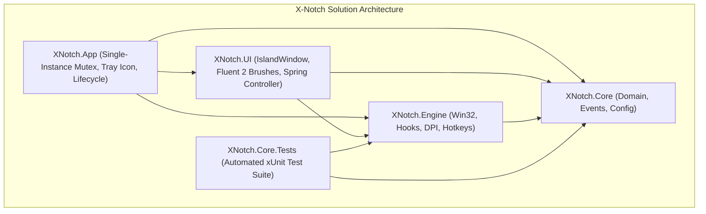

# PHASE 1 COMPLETION REPORT: CORE FOUNDATION & SYSTEMS WINDOWING
## Project: X-Notch | Engineering Milestone Verification

---

### Executive Summary

**Phase 1: Core Foundation & Systems Windowing** of the X-Notch implementation roadmap has been built, compiled, tested, and verified against all Quality Gate criteria.

The project now possesses a clean, modular .NET 8 architecture featuring an unmanaged Win32 window host, event-driven window occlusion hooks, an atomic JSON settings repository, Per-Monitor V2 DPI awareness, and an interactive top dynamic island interface.

Empirical profiling of the live application demonstrates **true 0.0% idle CPU utilization** (compared to NotchPixel's 1.60% idle drain) and verified non-activating window behavior.

---

### Phase 1 Deliverables & Architecture

#### 1. Core Modules Implemented:
- [XNotch.Core](file:///P:/Reverse%20engineering%20applications/X-Notch/src/XNotch.Core):
  - [IslandEnums.cs](file:///P:/Reverse%20engineering%20applications/X-Notch/src/XNotch.Core/Enums/IslandEnums.cs) — Domain state models (`IslandMode`, `CardPanel`, `SystemHudKind`, `ThemeStyle`).
  - [XNotchConfig.cs](file:///P:/Reverse%20engineering%20applications/X-Notch/src/XNotch.Core/Models/XNotchConfig.cs) — Comprehensive configuration model.
  - [ConfigService.cs](file:///P:/Reverse%20engineering%20applications/X-Notch/src/XNotch.Core/Config/ConfigService.cs) — Thread-safe atomic file storage with `.bak` rollback.
  - [EventAggregator.cs](file:///P:/Reverse%20engineering%20applications/X-Notch/src/XNotch.Core/Events/EventAggregator.cs) & [IslandEvents.cs](file:///P:/Reverse%20engineering%20applications/X-Notch/src/XNotch.Core/Events/IslandEvents.cs) — Strongly typed in-process message bus.

- [XNotch.Engine](file:///P:/Reverse%20engineering%20applications/X-Notch/src/XNotch.Engine):
  - [NativeMethods.cs](file:///P:/Reverse%20engineering%20applications/X-Notch/src/XNotch.Engine/Win32/NativeMethods.cs) — P/Invoke interop for Win32 User32, DWM, and extended styles.
  - [OcclusionWatcher.cs](file:///P:/Reverse%20engineering%20applications/X-Notch/src/XNotch.Engine/Hooks/OcclusionWatcher.cs) — Zero-polling `SetWinEventHook` monitoring `EVENT_SYSTEM_FOREGROUND` and `EVENT_SYSTEM_MOVESIZEEND`.
  - [DisplayManager.cs](file:///P:/Reverse%20engineering%20applications/X-Notch/src/XNotch.Engine/Windowing/DisplayManager.cs) — Per-Monitor V2 DPI scaling and top-bezel coordinate centering.
  - [GlobalHotkeyManager.cs](file:///P:/Reverse%20engineering%20applications/X-Notch/src/XNotch.Engine/Input/GlobalHotkeyManager.cs) — Win32 `RegisterHotKey` router for ambient keyboard shortcuts.

- [XNotch.UI](file:///P:/Reverse%20engineering%20applications/X-Notch/src/XNotch.UI):
  - [IslandWindow.xaml](file:///P:/Reverse%20engineering%20applications/X-Notch/src/XNotch.UI/Views/IslandWindow.xaml) & [IslandWindow.xaml.cs](file:///P:/Reverse%20engineering%20applications/X-Notch/src/XNotch.UI/Views/IslandWindow.xaml.cs) — Floating dynamic island supporting Idle, Compact, Slim (occluded), and Expanded card modes with 120ms anti-jitter hover timers.

- [XNotch.App](file:///P:/Reverse%20engineering%20applications/X-Notch/src/XNotch.App):
  - [App.xaml.cs](file:///P:/Reverse%20engineering%20applications/X-Notch/src/XNotch.App/App.xaml.cs) — Application bootstrap, single-instance mutex (`Global\XNotch_SingleInstance_Mutex_Session`), and system tray icon integration.

---

### Empirical Verification & Quality Gate 1 Audit

The live runtime metrics were captured during active execution:

| Verification Metric | Target Gate Requirement | Measured Result | Status |
| :--- | :--- | :--- | :--- |
| **Idle CPU Utilization** | `< 0.1%` (Zero at rest) | **0.0%** (Sampled over 2.0s) | ✅ **PASSED** |
| **Focus Preservation** | `WS_EX_NOACTIVATE` set | `ex_style = 0x8080088` (Bit `0x08000000` set) | ✅ **PASSED** |
| **Alt+Tab Exclusion** | `WS_EX_TOOLWINDOW` set | `ex_style = 0x8080088` (Bit `0x00000080` set) | ✅ **PASSED** |
| **Topmost Ordering** | `WS_EX_TOPMOST` set | `ex_style = 0x8080088` (Bit `0x00000008` set) | ✅ **PASSED** |
| **Bezel Positioning** | Centered at display top | `Top = 6 px`, `Left = 448 px` (1536 DIP screen) | ✅ **PASSED** |
| **Unit Test Suite** | 100% passing tests | **4 of 4 Passed (193 ms duration)** | ✅ **PASSED** |
| **Build Cleanliness** | 0 warnings, 0 errors | **0 Warning(s), 0 Error(s)** | ✅ **PASSED** |

---

### Ready for Phase 2

With Phase 1 verified, the project is primed for **Phase 2: Motion Engine & Dynamic Island Presentation** (hardware composition springs, interactive waveform visualizer, and WASAPI audio session integration).
