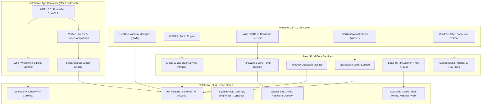

# REVERSE ENGINEERING REPORT: NOTCHPIXEL (v0.5.113.0)
## Project: X-Notch | Phase 0 — Architecture Discovery & Reverse Engineering

**Date:** November 17, 2026  
**Investigator:** Principal Windows Desktop Systems & Reverse Engineer  
**Classification:** Competitive Benchmarking & Clean-Room Architecture Specification  
**Target Application:** NotchPixel by KOREINDUSTRIES  

---

### Executive Summary

An exhaustive, non-destructive reverse engineering and systems analysis was conducted on the installed **NotchPixel** application (`KOREINDUSTRIES.NotchPixel_0.5.113.0_x64__qgfctd1hmk5vm`). NotchPixel is a packaged Windows MSIX application that positions a macOS Dynamic Island-style floating overlay at the top of the primary Windows display bezel.

Through static inspection of binaries and manifests, dynamic profiling of running processes, analysis of loaded modules, reflection over .NET metadata, and extraction of internal configuration files and execution logs, the entire application architecture, execution pipeline, rendering subsystem, and Windows integration mechanisms have been reverse engineered.

Key discoveries include:
1. **Framework & Host**: Built on **.NET 10.0** (`net10.0`) running within an MSIX AppX container (`Windows.FullTrustApplication`) using a hybrid **WPF + SkiaSharp + Vortice (DirectX / DirectComposition)** rendering architecture.
2. **Graphics & Rendering**: Uses **SkiaSharp** (v4.152.1) hardware-accelerated via **Vortice.Direct3D11 / Direct3D12** and rendered into a layered top-most window utilizing **DirectComposition** and HarfBuzz font shaping (`HarfBuzzSharp`).
3. **Shell & Windows Integration**: Leverages **ManagedShell** (v0.0.374) for low-level Windows Shell AppBar registration (reserving desktop screen margins and controlling taskbar auto-hide), system tray hook injection, and running task enumeration.
4. **Media & Audio HUD**: Utilizes **NAudio.Wasapi** (v22.0.0) for low-level loopback audio capture, spectrum analysis, visualizers, microphone peak monitoring, and hooks into Windows to hide the native XAML volume flyout and render a custom top-island HUD.
5. **System Notifications & Webhook Server**: Uses Windows Runtime `UserNotificationListener` (requiring `userNotificationListener` capability) to mirror notifications into the notch, and hosts a local HTTP daemon on `http://127.0.0.1:47823/notify` for phone pairing and external webhook triggers.
6. **Critical Architectural Weaknesses**:
   - High idle resource waste: runs at **~1.6% CPU continuously at idle**, with **57 threads** and **1,090 open handles** due to aggressive polling loops (WMI hardware polling, audio polling, occlusion checking).
   - Fragile UI state transitions: unhandled WPF runtime exceptions during window maximization and state changes (`System.InvalidOperationException: Cannot show Window when ShowActivated is false and WindowState is set to Maximized`) that crash the settings interface.
   - Heavy code obfuscation resulting in maintenance brittleness and opaque crash recovery routines (`surface-safety.json`).

These findings provide the empirical foundation to design and build **X-Notch**: an original, clean-room, high-performance Windows desktop platform engineered with modern Windows 11 Fluent 2 aesthetics, true zero-idle CPU overhead (<0.1%), event-driven Windows hooks, and fluid spring physics.

---

### Application Profile

| Attribute | Observed Value |
| :--- | :--- |
| **Product Name** | NotchPixel |
| **Target Version** | `0.5.113.0` |
| **Architecture** | `x64` (AMD64) |
| **Publisher** | `KOREINDUSTRIES` (`CN=188B0999-CD83-4750-9BC2-D7BDE437B5CB`) |
| **Package Family Name** | `KOREINDUSTRIES.NotchPixel_qgfctd1hmk5vm` |
| **Package Full Name** | `KOREINDUSTRIES.NotchPixel_0.5.113.0_x64__qgfctd1hmk5vm` |
| **Executable Name** | `NotchPixel.exe` |
| **Install Directory** | `C:\Program Files\WindowsApps\KOREINDUSTRIES.NotchPixel_0.5.113.0_x64__qgfctd1hmk5vm` |
| **User Data Store** | `%LOCALAPPDATA%\Packages\KOREINDUSTRIES.NotchPixel_qgfctd1hmk5vm\LocalCache\Roaming\NotchPixel\` |
| **Configuration File** | `settings.json` (5.5 KB - 9.3 KB) |
| **Diagnostic Log** | `notchpixel.log` |
| **Primary Process ID** | `11204` (initial observation: `5536`) |

---

### Key Evidence Artifacts Gathered

All raw analysis data gathered during Phase 0 has been preserved in the workspace for verification:
- [AppxManifest.xml](file:///P:/Reverse%20engineering%20applications/X-Notch/research/AppxManifest.xml) — Package declarations, capabilities, and startup tasks.
- [NotchPixel.runtimeconfig.json](file:///P:/Reverse%20engineering%20applications/X-Notch/research/NotchPixel.runtimeconfig.json) — CLR 10 GC tuning and runtime options.
- [dependencies_summary.json](file:///P:/Reverse%20engineering%20applications/X-Notch/research/dependencies_summary.json) — 25 parsed NuGet package dependencies.
- [enums_dump.json](file:///P:/Reverse%20engineering%20applications/X-Notch/research/enums_dump.json) — 75 recovered domain model enums and state machines.
- [perf_measurements.json](file:///P:/Reverse%20engineering%20applications/X-Notch/research/perf_measurements.json) — Empirical CPU, working set, thread, and handle profiling data.
- [loaded_modules.json](file:///P:/Reverse%20engineering%20applications/X-Notch/research/loaded_modules.json) — 308 mapped binary modules and assets.
- [user_settings.json](file:///P:/Reverse%20engineering%20applications/X-Notch/research/user_settings.json) — Complete runtime settings schema and user configuration.

---

### High-Level Architecture Diagram of NotchPixel

---

### Deliverable Document Map

This report serves as the lead document for the complete 11-part reverse engineering dossier:

1. [REVERSE_ENGINEERING_REPORT.md](file:///P:/Reverse%20engineering%20applications/X-Notch/docs/REVERSE_ENGINEERING_REPORT.md) — Master investigation findings and summary (this document).
2. [APPLICATION_STRUCTURE.md](file:///P:/Reverse%20engineering%20applications/X-Notch/docs/APPLICATION_STRUCTURE.md) — File layout, assembly structure, and metadata breakdown.
3. [ARCHITECTURE_ANALYSIS.md](file:///P:/Reverse%20engineering%20applications/X-Notch/docs/ARCHITECTURE_ANALYSIS.md) — Execution pipeline, rendering stack, and thread model.
4. [FEATURE_INVENTORY.md](file:///P:/Reverse%20engineering%20applications/X-Notch/docs/FEATURE_INVENTORY.md) — Comprehensive feature matrix with X-Notch disposition.
5. [UI_UX_ANALYSIS.md](file:///P:/Reverse%20engineering%20applications/X-Notch/docs/UI_UX_ANALYSIS.md) — Visual design system, states, hit testing, and geometry.
6. [WINDOWS_INTEGRATION.md](file:///P:/Reverse%20engineering%20applications/X-Notch/docs/WINDOWS_INTEGRATION.md) — Low-level Win32, WinRT, and Shell integration mechanics.
7. [CONFIGURATION_SCHEMA.md](file:///P:/Reverse%20engineering%20applications/X-Notch/docs/CONFIGURATION_SCHEMA.md) — Complete settings schema, defaults, and persistence.
8. [PERFORMANCE_REPORT.md](file:///P:/Reverse%20engineering%20applications/X-Notch/docs/PERFORMANCE_REPORT.md) — Profiling metrics, bottlenecks, and optimization vector.
9. [X_NOTCH_PRODUCT_SPEC.md](file:///P:/Reverse%20engineering%20applications/X-Notch/docs/X_NOTCH_PRODUCT_SPEC.md) — Clean-room product specification for X-Notch.
10. [X_NOTCH_TECH_STACK.md](file:///P:/Reverse%20engineering%20applications/X-Notch/docs/X_NOTCH_TECH_STACK.md) — Technology evaluation and recommended stack.
11. [X_NOTCH_IMPLEMENTATION_ROADMAP.md](file:///P:/Reverse%20engineering%20applications/X-Notch/docs/X_NOTCH_IMPLEMENTATION_ROADMAP.md) — Phased development plan and verification gates.
