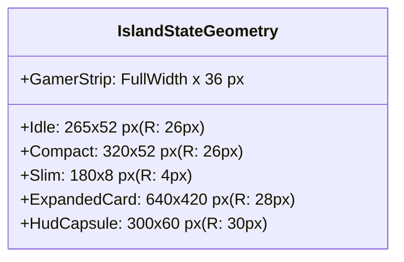
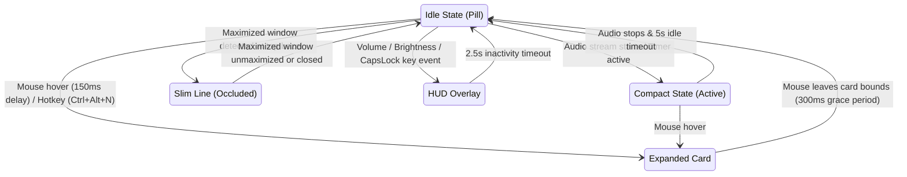

# UI / UX & INTERACTION DESIGN ANALYSIS: NOTCHPIXEL
## Visual Architecture, States, Geometry, and Motion Analysis

---

### 1. Geometry & Screen Anatomy

NotchPixel positions its primary visual surface at the geometric top-center of the primary display, aligning seamlessly with the physical screen bezel.



#### Detailed Dimension Metrics (at 100% DPI):
- **Top Margin Offset (`TopGapDip`)**: `6 px` default (or `0 px` when docked flush to bezel).
- **Idle Pill Dimensions**: `265 px` width $\times$ `52 px` height.
- **Corner Radius (`CornerRoundness`)**: `100%` setting yields a perfect capsule (`radius = height / 2 = 26 px`).
- **Expanded Card Dimensions**: `640 px` width $\times$ `420 px` height (`radius = 28 px`).
- **Drop Shadow**: Soft multi-layered gaussian blur:
  - Ambient: `0px 4px 12px rgba(0, 0, 0, 0.40)`
  - Key light: `0px 12px 36px rgba(0, 0, 0, 0.65)`
  - Border stroke: `1px solid rgba(255, 255, 255, 0.12)`

---

### 2. Interaction States & Transitions

NotchPixel implements a 7-stage state model with distinct interaction triggers:



#### Interaction Parameters:
- **Hover Delay (`HoverDelayMs`)**: Default `150 ms`. Prevents accidental expansion when the user mouses quickly to browser tabs or window controls.
- **Grace Period (Mouse Leave)**: `300 ms` before collapsing, allowing users to slip the cursor off the card momentarily without losing context.
- **Occlusion Trigger (`SlimWhenCovered`)**: Constantly checks the bounding box `(827, 0) - (1092, 52)`. If any window of class `Chrome_WidgetWin_1`, `CabinetWClass`, etc., is maximized covering that area, the island collapses into an 8px line.

---

### 3. Hit-Testing Engine (`IslandHit`)

Analysis of `enums_dump.json` revealed over **100 discrete hit zones** within the SkiaSharp scene graph:

#### Primary Hit Categories:
1. **Media Controls**: `PlayPause`, `Next`, `Previous`, `Progress` (timeline seeking), `MusicVolume`, `MusicMute`, `MusicSource`.
2. **Card Navigation**: `Tab`, `CardPanel` selector pills across the top of the expanded card.
3. **Drop Shelf**: `ShelfItem`, `ShelfRemove`, `ShelfClear`, `ShelfShare`, `ShelfToPhone`, `ShelfSelectAll`.
4. **Clipboard & Snippets**: `ClipboardItem`, `ClipboardRemove`, `ClipboardClear`, `ClipboardPin`, `SnippetItem`.
5. **HUD & Sliders**: `BrightnessSlider`, `VolumeSlider`, `NightLightToggle`, `MuteToggle`, `BluetoothToggle`, `WiFiToggle`.
6. **Screen Tools**: `Screenshot`, `Snip`, `ScreenRecord`, `CaptureCard`, `CaptureCopy`.
7. **AI & Chat**: `AgentPill`, `AgentRow`, `AgentStop`, `ChatShow`, `ChatStop`.

Because NotchPixel uses SkiaSharp rather than standard Windows UI controls, all hit testing is performed manually via geometric bounding box intersection against mouse coordinate vectors (`x, y`).

---

### 4. Typography Scale & Hierarchy

NotchPixel embeds Vercel's **Geist** font family for all text rendering:

| Typography Role | Font Family | Size | Weight | Line Height | Usage |
| :--- | :--- | :--- | :--- | :--- | :--- |
| **Headline 1** | Geist | `22 px` | Bold (700) | `28 px` | Settings page titles, Welcome headers |
| **Card Title** | Geist | `15 px` | SemiBold (600) | `20 px` | Active card panel title, Track name |
| **Body Primary** | Geist | `13 px` | Regular (400) | `18 px` | Settings labels, Notification text |
| **Subtext / Meta** | Geist | `11 px` | Regular (400) | `14 px` | Artist name, timestamps, hotkey badges |
| **Monospace Time** | Geist Mono | `14 px` | Medium (500) | `16 px` | Clock readout, stopwatch/timer |
| **Metrics Readout** | Geist Mono | `11 px` | Medium (500) | `14 px` | FPS counter, CPU/GPU % readout |
| **Pixel Display** | GeistPixel-Square | `10 px` | Regular (400) | `10 px` | Retro visualizer, pixel pet captions |

---

### 5. Color Tokens & Theme Architecture

NotchPixel supports two core theme configurations (`Surface: black` and `Surface: theme`):

```json
{
  "SurfaceBackground": "#0B0B0C",
  "CardBackground": "#161618",
  "ElevatedCard": "#1E1E22",
  "BorderSubtle": "rgba(255, 255, 255, 0.08)",
  "BorderStrong": "rgba(255, 255, 255, 0.16)",
  "TextPrimary": "#F5F5F7",
  "TextSecondary": "#8E8E93",
  "TextTertiary": "#48484A",
  "AccentDefault": "#FFFFFF",
  "AccentSuccess": "#30D158",
  "AccentWarning": "#FF9F0A",
  "AccentDanger": "#FF453A"
}
```

---

### 6. UI/UX Critique & Opportunities for X-Notch

While NotchPixel achieves an attractive superficial resemblance to the macOS Dynamic Island, several critical UX flaws were identified:

1. **Abrupt Morphing Physics**:
   - NotchPixel relies on standard linear or cubic easing for expansion. It lacks true momentum-based spring physics, resulting in a somewhat rigid, mechanical expansion rather than the organic, fluid feel of iOS/macOS.
   - *X-Notch Design Goal*: Implement **Damped Harmonic Oscillator spring physics** ($\zeta = 0.82, \omega_n = 28 \text{ rad/s}$) for fluid stretch, overshoot, and settle.

2. **Window Maximization Conflicts**:
   - The settings window uses non-standard window chrome that crashes when maximized (`InvalidOperationException: Cannot show Window when ShowActivated is false and WindowState is set to Maximized`).
   - *X-Notch Design Goal*: Use standard modern WinUI 3 windowing with native snap layouts, proper DWM resize borders, and full Mica Alt backdrop support.

3. **Hit-Testing Precision & Padding**:
   - Tiny close buttons and tab targets (16x16px) make touch and precision mouse clicking frustrating.
   - *X-Notch Design Goal*: Enforce strict 32x32px minimum touch/pointer targets with visual feedback states (hover, active, pressed).
