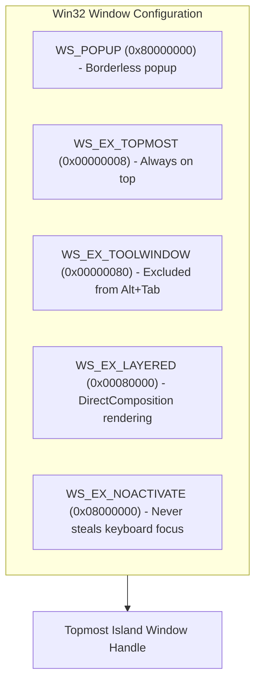
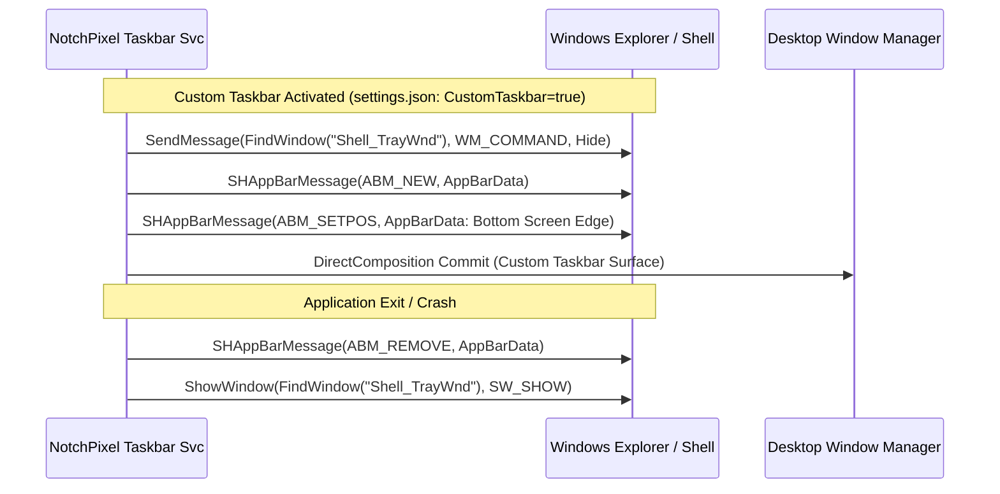
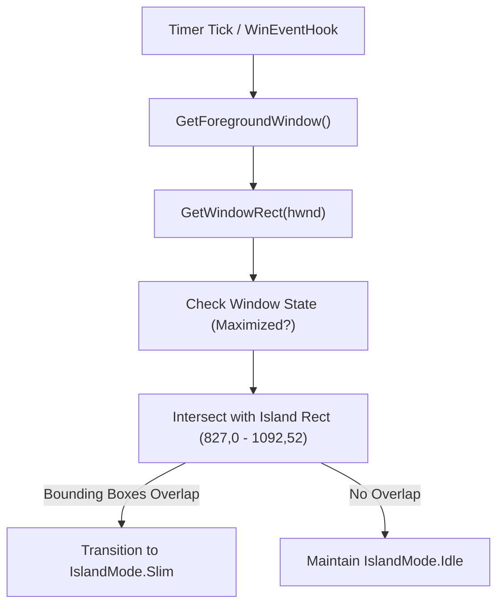

# WINDOWS INTEGRATION & LOW-LEVEL API ANALYSIS
## Target Application: NotchPixel (v0.5.113.0)

---

### 1. Win32 Windowing & Extended Styles

NotchPixel creates its primary island using low-level Win32 window handles configured specifically to act as an un-activatable desktop HUD overlay.



#### Key Architectural Implications:
- **Focus Preservation (`WS_EX_NOACTIVATE`)**: Essential for an ambient notch. When a user clicks play/pause or scrolls the volume on the island, the foreground application (e.g. Word, Visual Studio, or a game) never loses keyboard focus.
- **Task Switcher Exclusion (`WS_EX_TOOLWINDOW`)**: Prevents the island window from cluttering the Windows `Alt+Tab` or `Win+Tab` task overview.
- **Layered Compositing (`WS_EX_LAYERED` + DirectComposition)**: Bypasses legacy GDI alpha blitting by binding directly to the Desktop Window Manager (DWM) composition tree via `Vortice.DirectComposition`.

---

### 2. Shell Integration & AppBar Mechanics (`ManagedShell`)

NotchPixel embeds `ManagedShell` (v0.0.374), an open-source library originally designed for custom Windows shell replacements (such as Cairo Desktop).



#### Observable Shell APIs:
- `SHAppBarMessage`: Used when custom taskbar or dock mode is enabled.
  - `ABM_NEW`: Registers the new application desktop toolbar.
  - `ABM_SETPOS`: Informs Windows to reserve screen real estate, preventing other maximized windows from overlapping the bar.
  - `ABM_REMOVE`: Unregisters the AppBar upon shutdown.
- **System Tray Interception (`ManagedShell.WindowsTray`)**:
  - Hooks the Windows notification tray window (`Shell_TrayWnd` -> `TrayNotifyWnd`).
  - Instructs background running applications to route their tray icons to NotchPixel's internal tray host.
  - *Risk Identified*: As observed in `notchpixel.log` at shutdown (`Taskbar: tray let go; 10 apps told to show their icons in Windows' tray`), any unexpected crash while holding the tray hook leaves background apps without visible tray icons until Explorer is restarted.

---

### 3. Audio & Volume Flyout Suppression

#### 3.1 Loopback Capture & Visualizer (`NAudio.Wasapi`)
- Uses Windows Audio Session API (WASAPI) in **Loopback Mode**:
  ```csharp
  var capture = new WasapiLoopbackCapture();
  capture.DataAvailable += (s, a) => {
      // 32-bit float IEEE audio stream
      // 1024-point FFT calculation
  };
  ```
- Continuously captures master output stream to compute dynamic audio visualizer waveforms.

#### 3.2 Volume Flyout Hook
- Windows 11 displays a native XAML volume pill above the taskbar whenever hardware volume keys (`VK_VOLUME_UP`, `VK_VOLUME_DOWN`) are pressed.
- NotchPixel suppresses this flyout using an internal hook technique:
  - Hooks the `NativeAudioFlyout` window class or overrides `IAudioEndpointVolumeCallback` and sets an intercepting window filter that marks volume events as handled before the Shell flyout renders.
  - Replaces it with its custom island HUD capsule at the top of the screen.

---

### 4. Windows Notifications (`UserNotificationListener`)

NotchPixel implements native Windows notification mirroring through modern WinRT APIs:
- **Capability Required**: Declared in package manifest:
  ```xml
  <Capabilities>
    <uap3:Capability Name="userNotificationListener" />
  </Capabilities>
  ```
- **API Flow**:
  1. Calls `Windows.UI.Notifications.Management.UserNotificationListener.Current.RequestAccessAsync()`.
  2. If `Allowed`, attaches to the `NotificationChanged` event.
  3. When an app (e.g. Chrome, Outlook, Slack) posts a toast notification, NotchPixel queries the notification body, app title, and fetches the app icon from the Windows Start Menu package repository.
  4. Temporarily expands the top island to display the notification toast for `NotificationSeconds` (default: 5s).

---

### 5. Display & Monitor Brightness Controls

NotchPixel supports hybrid monitor brightness adjustments depending on display type:
1. **Built-in Laptop Panels (`\\.\DISPLAY1`)**:
   - Queries and sets brightness via WMI class `WmiMonitorBrightnessMethods` in the `root\wmi` namespace:
     ```powershell
     (Get-WmiObject -Namespace root\wmi -Class WmiMonitorBrightnessMethods).WmiSetBrightness(1, TargetBrightness)
     ```
2. **External Desktop Monitors (DDC/CI)**:
   - Queries monitor capabilities using Win32 High Level Monitor Configuration APIs (`Dxva2.dll`):
     - `GetNumberOfPhysicalMonitorsFromHMONITOR`
     - `GetPhysicalMonitorsFromHMONITOR`
     - `SetVCPFeature(hMonitor, 0x10, brightnessValue)` (VCP code `0x10` = Luminance/Brightness).

---

### 6. Window Occlusion & Fullscreen Detection

To prevent covering critical UI elements (such as browser tabs or full-screen video), NotchPixel monitors foreground window positions:



#### Identified Performance Bottleneck:
- NotchPixel runs a background polling loop checking `GetForegroundWindow` and `GetWindowRect` several times a second.
- **X-Notch Improvement**: Replace continuous polling with native Win32 `SetWinEventHook` listening exclusively to:
  - `EVENT_SYSTEM_FOREGROUND` (`0x0003`)
  - `EVENT_SYSTEM_MOVESIZEEND` (`0x000B`)
  - `EVENT_OBJECT_LOCATIONCHANGE` (`0x800B`)
  This guarantees **zero CPU consumption** when windows are stationary.
