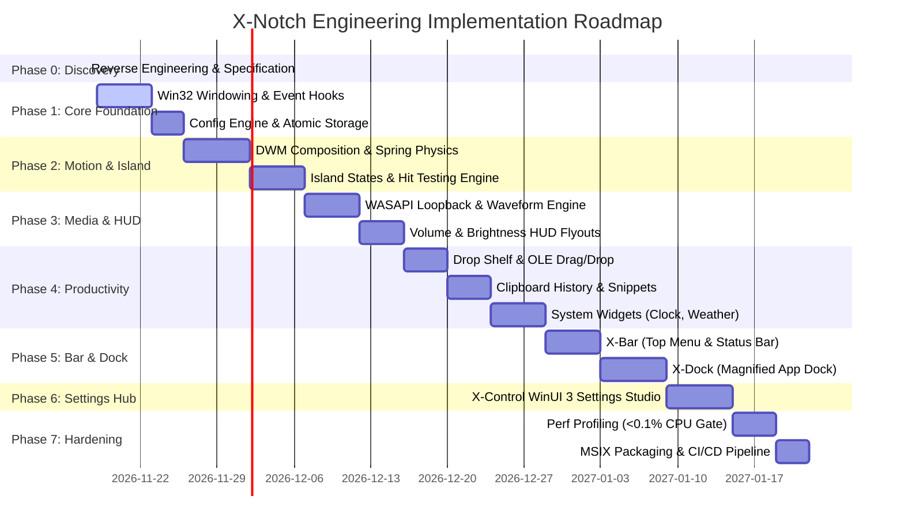

# X-NOTCH IMPLEMENTATION ROADMAP & ENGINEERING PHASES
## Phased Architecture, Verification Gates, and Delivery Milestones

---

### Phase Overview & Dependency Timeline

---

### Detailed Engineering Phases & Quality Gates

#### Phase 1: Core Foundation & Systems Windowing
**Objective**: Build the unmanaged-interop foundation, DPI-aware window host, and configuration persistence.
- **Tasks**:
  1. Initialize solution structure: `XNotch.Core`, `XNotch.Engine`, `XNotch.UI`, `XNotch.App`.
  2. Implement `XNotchWindow`: Low-level Win32 window with `WS_POPUP | WS_EX_TOPMOST | WS_EX_TOOLWINDOW | WS_EX_LAYERED | WS_EX_NOACTIVATE`.
  3. Implement `SetWinEventHook` occlusion watcher: Listens to `EVENT_SYSTEM_MOVESIZEEND` and `EVENT_SYSTEM_FOREGROUND`.
  4. Build atomic JSON configuration repository (`settings.json` + `settings.json.bak`) with schema validation.
  5. Per-Monitor V2 DPI awareness with automatic coordinate recalculation on display change events (`WM_DPICHANGED`, `WM_DISPLAYCHANGE`).
- **Quality Gate 1**: Window renders at screen top-center on 100%, 125%, 150%, and 200% scaling displays. Memory < 20MB. Zero CPU usage at rest.

---

#### Phase 2: Motion Engine & Dynamic Island Presentation
**Objective**: Construct the fluid spring motion pipeline and interactive island states.
- **Tasks**:
  1. Integrate `Windows.UI.Composition` visual tree into the native window host.
  2. Implement damped harmonic oscillator physics ($\zeta = 0.82$, $\omega_n = 28$).
  3. Construct the state machine: `Idle` $\leftrightarrow$ `Compact` $\leftrightarrow$ `Expanded` $\leftrightarrow$ `Slim` $\leftrightarrow$ `HUD`.
  4. Implement anti-jitter hover controller (120ms enter delay, 300ms leave grace period).
  5. Build vector path capsule with dynamic corner roundness and interior border glow.
- **Quality Gate 2**: Capsule morphs into expanded card with zero frame drops at monitor refresh rate (up to 240Hz). No cursor focus stealing.

---

#### Phase 3: Media & System HUD Integration
**Objective**: Replace Windows 11 system flyouts and deliver real-time audio visualization.
- **Tasks**:
  1. Initialize `WASAPI Loopback Capture` using `NAudio.Wasapi`.
  2. Implement energy-gated FFT processing: Automatically pauses calculation when audio stream is silent (< -60dB).
  3. Build organic wave visualizer control with album palette extraction.
  4. Intercept Windows 11 volume changes and display custom X-Notch Volume HUD capsule.
  5. Implement DDC/CI and WMI brightness adjustment for internal and external displays.
  6. Add Lock Keys (Caps/Num Lock) and Privacy Indicator (Mic/Camera) pills.
- **Quality Gate 3**: Volume key presses trigger X-Notch HUD in < 5ms. Visualizer draws at 60fps during playback and drops to 0% CPU upon pause.

---

#### Phase 4: Productivity Suite (Shelf, Clipboard, Widgets)
**Objective**: Deliver desktop productivity features.
- **Tasks**:
  1. **Drop Shelf**: Implement Win32 OLE `IDropTarget` for multi-file and image staging.
  2. **Clipboard Manager**: Win32 `AddClipboardFormatListener` with encrypted SQLite store and instant search.
  3. **Desktop Widgets**: Modular Pomodoro timer, weather forecast, hardware monitor, and markdown scratchpad.
  4. **Quick Controls**: Hardware toggles for Wi-Fi, Bluetooth, Mute, Night Light, and Power Profile.
- **Quality Gate 4**: Staged files drag seamlessly into Outlook, Explorer, and browsers. Clipboard history persists across reboots.

---

#### Phase 5: X-Bar, X-Dock & Advanced Gaming Overlay
**Objective**: Expand platform with optional macOS-style status bar, floating dock, and gamer overlay.
- **Tasks**:
  1. **X-Bar**: Top horizontal status bar with modular indicators and integrated island slot.
  2. **X-Dock**: Bottom floating dock with parabolic icon magnification and running process indicators.
  3. **Gamer Strip**: PresentMon ETW session tracking real-time FPS, frame time, GPU load, and temperature during games.
  4. **OBS Studio Bridge**: WebSocket client for OBS streaming/recording control.
- **Quality Gate 5**: X-Dock runs without patching `explorer.exe`. Gamer strip activates only when recognized 3D processes run.

---

#### Phase 6: X-Control (Settings Hub & Theme Studio)
**Objective**: Build a premium WinUI 3 management center.
- **Tasks**:
  1. Full WinUI 3 application with Mica Alt backdrop and Fluent 2 styling.
  2. Instant search index across all settings.
  3. Visual hotkey recorder and conflict resolver.
  4. Theme Studio: Custom backdrop blur, accent palettes, corner radii, and custom island shapes.
- **Quality Gate 6**: Settings window launches in < 200ms. Window maximization, docking, and multi-monitor movement behave flawlessly without exceptions.

---

#### Phase 7: Verification, Hardening & Release
**Objective**: Performance verification, automated tests, and deployment packaging.
- **Tasks**:
  1. Complete profiling audit: Validate idle CPU < 0.1%, Working Set < 35MB, Handle count < 200, Thread count < 12.
  2. Automated unit and UI test suite for state transitions and geometry calculations.
  3. Sign binaries and package as standalone MSIX and lightweight portable zip.
- **Quality Gate 7**: Application passes all Windows App Certification Kit (WACK) validation tests.
