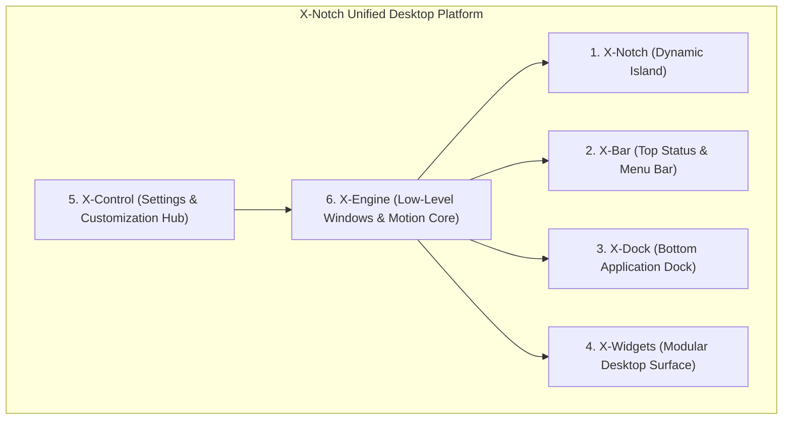

# X-NOTCH PRODUCT SPECIFICATION & CLEAN-ROOM VISION
## The Next-Generation Dynamic Island, Status Bar & Desktop Engine for Windows 11

---

### 1. Vision & Core Philosophy

**X-Notch** is an original, premium Windows desktop platform that bridges the gap between the refined, organic fluidity of macOS interface concepts (Dynamic Island, Menu Bar, Dock) and the modern, native design language of **Windows 11 (Fluent Design System 2.0)**.

Unlike superficial web-based overlays or clunky retrofits, X-Notch is engineered from the ground up as a native, ultra-lightweight systems utility that feels like an integral part of the Windows 11 operating system.

---

### 2. The Six Primary Architectural Components

#### 2.1 X-Notch (Top Floating Dynamic Island)
The flagship interface element: an organic capsule floating at the top bezel of the display that intelligently adapts to live context.
- **Idle Capsule**: Minimalist pill displaying subtle ambient state (clock, battery level, or silent blank).
- **Compact Island**: Automatically expands when background activities occur (music playback with live waveform visualizer, countdown timer, active download progress).
- **Expanded Card**: On hover (with a calibrated 120ms anti-jitter delay) or global shortcut, morphs smoothly via spring physics into an interactive command card:
  - *Media Hub*: Track scrubbing, volume wheel, source switching, and synchronized lyrics.
  - *Drop Shelf*: Drag-and-drop staging tray for files, screenshots, and text snippets.
  - *Quick Controls*: Hardware toggles (Wi-Fi, Bluetooth, Mute, Night Light, Performance profile).
  - *System Clipboard*: Instant searchable clipboard history with pin support.
- **HUD Capsule**: Temporary, non-intrusive replacement for Windows 11 system flyouts (Volume, Brightness, Caps/Num Lock, Mic Mute, Privacy indicators).
- **Smart Slimming**: Automatically collapses to a non-intrusive 4px line when any foreground window is maximized or occludes the notch region.

#### 2.2 X-Bar (Top Information & Status Bar)
An optional, persistent top bar designed for power users who prefer a full menu bar layout:
- Left: Active application context, quick workspace shortcuts.
- Center: Integrated X-Notch capsule.
- Right: Modular status indicators (Clock, Battery, Network, Volume, Notification bell).
- Native auto-hide and multi-monitor mirroring.

#### 2.3 X-Dock (Bottom Floating Application Dock)
An optional floating application dock designed to coexist cleanly with or gracefully replace the Windows taskbar:
- Smooth parabolic magnification on hover.
- Live running indicators (active window indicator dots).
- Drag-and-drop folder stacks with fan-out or grid view.
- Non-destructive operation: does not patch or corrupt explorer.exe.

#### 2.4 X-Widgets (Desktop Widgets Engine)
Lightweight, floating desktop widgets built with Windows 11 Mica and Acrylic materials:
- System Monitor: CPU, GPU load/temperature, RAM, network bandwidth.
- World Clock & Pomodoro Focus Timer.
- Weather with animated vector conditions.
- Markdown Quick Notes & Calculator.

#### 2.5 X-Control (Central Settings & Theme Hub)
A high-performance WinUI 3 settings application featuring:
- Instant fuzzy search across all preferences.
- Visual Hotkey Manager with conflict detection.
- Theme Studio: custom acrylic opacity, corner radii, border glow, accent palette.
- Backup & Profile Export/Import.

#### 2.6 X-Engine (Core Runtime Engine)
The low-level systems foundation powering all visual components:
- Event-driven Win32 windowing with zero-polling occlusion tracking.
- Physics-based spring motion engine ($\zeta = 0.82$, $\omega_n = 28$).
- WASAPI low-latency loopback audio capture with energy-gated FFT processing.
- Multi-monitor management with Per-Monitor V2 DPI scaling.

---

### 3. Design System & Visual Tokens

#### 3.1 Materials & Translucency
X-Notch utilizes Windows 11 **Mica Alt** and **Desktop Acrylic** materials:
- **Surface Backdrop**: `Mica Alt` with subtle tinting (`rgba(15, 15, 18, 0.78)` in Dark Mode; `rgba(255, 255, 255, 0.82)` in Light Mode).
- **Gaussian Blur Radius**: `30 px` with noise texture overlay.
- **Border Stroke**: `1 px` interior hairline stroke (`rgba(255, 255, 255, 0.10)` on dark surfaces; `rgba(0, 0, 0, 0.08)` on light surfaces).
- **Elevation Shadow**: Multi-pass ambient and directional drop shadows simulating a 16dp elevation off the display panel.

#### 3.2 Physics & Animation Tokens
Motion in X-Notch is governed by **Damped Harmonic Motion** equations:
$$F = -k x - c v$$
- **Spring Stiffness ($k$)**: `280 N/m`
- **Damping Ratio ($\zeta$)**: `0.82` (slight, organic overshoot without bounce fatigue)
- **Mass ($m$)**: `1.0 kg`
- **Initial Velocity Injection**: Scales dynamically with cursor entry velocity.
- **Frame Rate Lock**: Synchronized via `DwmFlush` / Composition frames to match 60Hz, 120Hz, 144Hz, or 240Hz display panels seamlessly.

#### 3.3 Typography
- **Primary Interface**: `Segoe UI Variable` (Native Windows 11 font with optical sizing axes: Text, Display, Small).
- **Monospaced Figures**: `Cascadia Code` / `Geist Mono` for timer counters and hardware stats.
