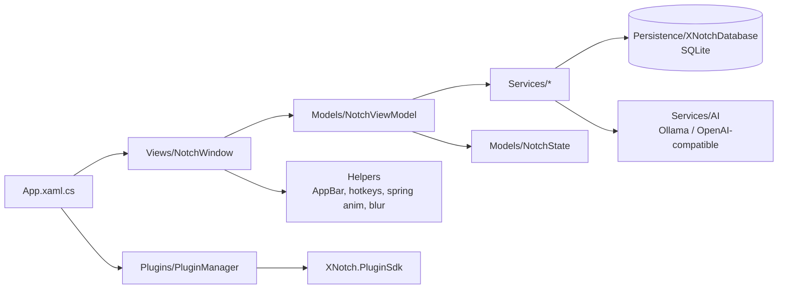

# Codebase Map: `src/XNotch`

Back to [[00 Home]] · see also [[XNOTCH_TARGET_ARCHITECTURE]], [[PLUGIN_SYSTEM_SUMMARY]].

Stack: WPF, `net8.0-windows10.0.22621.0`, CommunityToolkit.Mvvm, Microsoft.Data.Sqlite, NAudio, System.Management. ~22k lines C#.

## Folders
| Folder | Role | Key files |
|---|---|---|
| `Views/` | XAML UI: island window, widgets, HUD, launcher, plugin browser | `NotchWindow.xaml`, `NotchShape.cs`, `HudOverlay`, `MusicLiveActivity`, `SpotlightLauncher` |
| `Views/Components/` | theme dictionaries | `DarkTheme`, `LightTheme`, `LiquidGlassTheme` |
| `Models/` | state + settings | `NotchViewModel`, `NotchState`, `AppSettings`, `NotchConstants` |
| `Services/` | system integrations, one class each | Media, Volume, Brightness, Battery, Calendar, Notification, Webcam, Lyrics, HardwareMonitor, Update, Theme, Shelf, UsbDevice, XDesktopBroadcast |
| `Services/AI/` | local/remote LLM providers + prompt sanitiser | `IAIProvider`, `OllamaProvider`, `OpenAICompatibleProvider`, `ContextSanitizer` |
| `Helpers/` | Win32 glue | `AppBarHelper`, `GlobalHotkey`, `LockKeyHook`, `SpringAnimation`, `BackdropBlurHelper`, `CameraBezelHelper` |
| `Persistence/` | SQLite store | `XNotchDatabase` |
| `Plugins/` | plugin host: load, manifest, context, library | `PluginManager`, `PluginManifest`, `PluginLibraryService`, `I*Plugin` |
| `Assets/` | fonts, icons, animations, bundled plugin DLLs | `BundledPlugins/*.dll` (whitelisted in `.gitignore`) |

## Runtime data on disk
| Path | Content |
|---|---|
| `%LOCALAPPDATA%\XNotch\` | `settings.json`, `xnotch.db`, `runtime.log`, LyricsCache |
| `%APPDATA%\XNotch\` | Plugins, intelligence DB + settings |
| `%APPDATA%\X-Notch\`, `%LOCALAPPDATA%\X-Notch\` | older naming: plugins, logs, updates (70 MB) |
| `%APPDATA%\WinNotch\` | legacy name, Plugins only |

> [!warning] Four app-data roots from three naming eras. Consider one migration to `XNotch`.

## Build
- `build.bat` or `dotnet build X-Notch.sln`
- Single-file publish: `dotnet publish src/XNotch/XNotch.csproj -c Release -o publish -p:PublishSingleFile=true`
